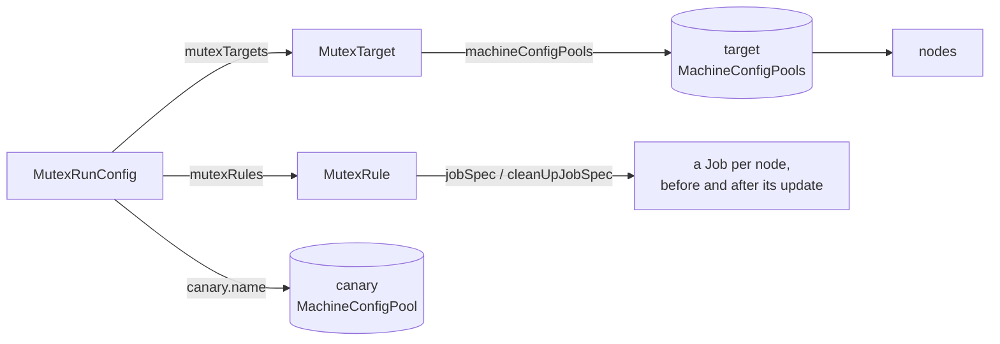
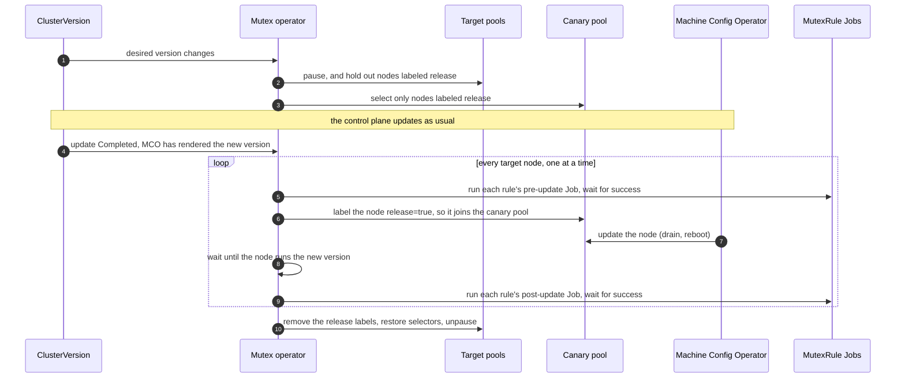
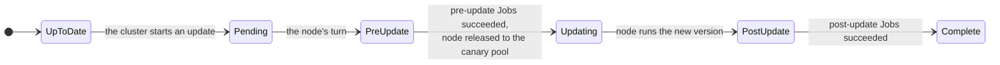

# OpenShift Node Upgrade Mutex Operator

During an OpenShift update, the Machine Config Operator (MCO) updates the nodes of each MachineConfigPool on its own schedule, `maxUnavailable` nodes at a time. It has no hook for work that must happen around each node.

This operator takes over the order. It updates target nodes **one at a time** and runs your **Jobs before and after each node**: move a workload away, check that a quorum is healthy, take a backup, or tell an external system that a node is going away and coming back.

It is an Ansible operator built with the [Operator SDK](https://sdk.operatorframework.io/) and needs OpenShift 4.14 or later.

## How it works

You describe the work with three custom resources:



| Resource | What it holds |
| --- | --- |
| `MutexRule` | A Job to run before each node is updated (`jobSpec`) and, optionally, one to run after it (`cleanUpJobSpec`). |
| `MutexTarget` | The MachineConfigPools whose nodes are updated one at a time. Its status lists the nodes, in update order. |
| `MutexRunConfig` | The rules, the targets and the canary pool. Its status shows the rollout. Create one per cluster; if there are more, only the oldest runs. |

When the cluster starts an update, the rollout goes like this:



Each node moves through these phases, which the MutexRunConfig reports in `status.nodes`:



The operator decides what the next step is from what it finds on the cluster each time it reconciles: pools, nodes, rendered MachineConfigs, Jobs, and its own annotations on nodes. Nothing is kept in memory, so a restarted operator picks up where the last one stopped.

### What the operator changes

| Object | Change | When |
| --- | --- | --- |
| Target pools | `spec.paused: true` and a `nodeupgrade.redhat-na-ssa.github.io/release DoesNotExist` term in `spec.nodeSelector` | From the start of an update until all target nodes are done. Pools that were already paused stay paused afterwards. |
| Canary pool | `spec.nodeSelector` becomes `nodeupgrade.redhat-na-ssa.github.io/release: "true"`; the original is saved in an annotation | Same |
| Target node | Label `nodeupgrade.redhat-na-ssa.github.io/release=true` | From its update until the rollout ends |
| Target node | Annotations `nodeupgrade.redhat-na-ssa.github.io/{phase,target-version,run-config,pre-update-complete,post-update-complete}` | Kept as a record of the last rollout. Deleting the MutexRunConfig removes them. |
| Your namespace | Jobs named `<jobName>-xxxxx` and `cleanup-<jobName>-xxxxx` | One per rule, node and stage. They are never deleted by the operator. |

## Installing

### From OperatorHub

The operator is published as **OpenShift Node Upgrade Mutex Operator** in the community catalog. Install it from **Operators > OperatorHub** in the console.

### From this repository

```shell
make deploy IMG=ghcr.io/redhat-na-ssa/openshift-node-upgrade-mutex-operator:0.3.0
```

To try a release that has not reached OperatorHub yet, create the CatalogSource in [`sample-manifests/catalogsource.yaml`](sample-manifests/catalogsource.yaml) and install the operator from it.

### Upgrading from 0.2.x

Version 0.3.0 changed the API group from `openshift-optional.skrzypek.io` to `nodeupgrade.redhat-na-ssa.github.io` and no longer needs the Node Feature Discovery operator or the `00-release-image-version` MachineConfig. Recreate your MutexRules, MutexTargets and MutexRunConfig with the new group, then remove the old resources, CRDs and the NFD setup if nothing else uses them. Do this between cluster updates.

## Using it

1. **Create a canary pool.** It must render the same MachineConfigs as your target pools, select no nodes, and not be paused. Start from [`sample-manifests/canary-machineconfigpool.yaml`](sample-manifests/canary-machineconfigpool.yaml).

   If a target pool has MachineConfigs of its own (an infra pool, for example), select those in the canary pool too. Otherwise its nodes get a second update when they return to their pool at the end of the rollout.

2. **Create a namespace for the Jobs** and give the Jobs' service account whatever access the Jobs need. The operator creates no RBAC for them.

3. **Create MutexRules.** For example:

   ```yaml
   apiVersion: nodeupgrade.redhat-na-ssa.github.io/v1alpha1
   kind: MutexRule
   metadata:
     name: database
     namespace: node-upgrade-mutex-operator
   spec:
     jobName: database          # Jobs are named database-xxxxx and cleanup-database-xxxxx
     jobNamespace: node-upgrade-mutex-jobs
     jobSpec:                   # any batch/v1 JobSpec
       backoffLimit: 2
       template:
         spec:
           serviceAccountName: database-maintenance
           restartPolicy: Never
           containers:
             - name: step-down
               image: registry.example.com/db-tools:1.4
               command: ["db-tool", "step-down", "--node", "$(NODE_NAME)"]
     cleanUpJobSpec:            # optional
       template:
         spec:
           serviceAccountName: database-maintenance
           restartPolicy: Never
           containers:
             - name: rejoin
               image: registry.example.com/db-tools:1.4
               command: ["db-tool", "wait-healthy", "--node", "$(NODE_NAME)"]
   ```

   The operator checks each Job template with a server-side dry run and sets the `Valid` condition. The Jobs it creates get these environment variables in every container and init container:

   | Variable | Value |
   | --- | --- |
   | `NODE_NAME` | The node being updated |
   | `TARGET_VERSION` | The OpenShift version it is being updated to |
   | `MUTEX_RULE` | The MutexRule's name |
   | `MUTEX_STAGE` | `pre-update` or `post-update` |

   The operator also adds a `metadata.name NotIn [<node>]` node affinity term, so a Job never runs on the node it is about. The rest of your affinity, node selector and tolerations are kept.

4. **Create a MutexTarget** naming the pools to update one node at a time. The master pool cannot be a target.

   ```yaml
   apiVersion: nodeupgrade.redhat-na-ssa.github.io/v1alpha1
   kind: MutexTarget
   metadata:
     name: workers
     namespace: node-upgrade-mutex-operator
   spec:
     machineConfigPools:
       - worker
   ```

5. **Create the MutexRunConfig.** Rules run in the order listed. Targets are updated in the order listed, and nodes within a pool by name. `namespace` defaults to the MutexRunConfig's namespace.

   ```yaml
   apiVersion: nodeupgrade.redhat-na-ssa.github.io/v1alpha1
   kind: MutexRunConfig
   metadata:
     name: rollout
     namespace: node-upgrade-mutex-operator
   spec:
     canary:
       name: canary
     mutexRules:
       - name: database
     mutexTargets:
       - name: workers
   ```

6. **Update the cluster as usual**, from the console or with `oc adm upgrade`. Follow the rollout with:

   ```shell
   oc get mutexrunconfig -n node-upgrade-mutex-operator -w
   oc get mutexrunconfig rollout -n node-upgrade-mutex-operator -o jsonpath='{.status}' | jq
   ```

## Status and troubleshooting

The MutexRunConfig has three conditions:

| Condition | Meaning |
| --- | --- |
| `ConfigValid` | The rules and targets exist and are `Valid`, and the canary pool is usable. The message lists what is wrong. |
| `Progressing` | `True` while a rollout runs. The reason says what the operator waits for. |
| `Degraded` | `True` when the rollout is stuck and needs you. |

| `Progressing` reason | What is happening |
| --- | --- |
| `Idle`, `RolloutComplete` | Nothing to do. |
| `PausingPools` | An update has started; target pools are being paused. |
| `WaitingForControlPlane` | Waiting for the ClusterVersion update to complete. |
| `WaitingForCanary` | Waiting for the MCO to render the new version for the canary pool. |
| `WaitingForNodes` | A target node is already being updated by the MCO (for example, it started before the pools were paused). |
| `WaitingForCluster` | An APIService is unavailable; the next node waits until it is back. |
| `RunningPreUpdateJobs`, `RunningPostUpdateJobs` | A rule's Job runs for the current node. |
| `UpdatingNode` | The current node is in the canary pool, being updated. |
| `NodeComplete`, `Finishing` | A node is done; the rollout moves on or wraps up. |
| `Blocked` | See the `Degraded` condition. |

| `Degraded` reason | What to do |
| --- | --- |
| `JobFailed` | Fix the cause, then delete the failed Job; the operator runs it again. To skip a rule for that node instead, add the rule (`<namespace>/<name>`) to the node's `nodeupgrade.redhat-na-ssa.github.io/pre-update-complete` (or `post-update-complete`) annotation, comma separated. |
| `NodeDegraded`, `CanaryDegraded` | The MCO cannot update the node. Fix it as you would any MCO problem; the rollout continues on its own. |
| `InvalidConfig` | A rule, target or the canary pool became invalid during a rollout. Fix it and the rollout continues. |
| `Conflict` | More than one MutexRunConfig exists. The oldest one runs; delete the others. |
| `PoolMembership` | A node matches two custom pools. The MCO cannot update it either. |
| `ApplyFailed` | A patch or Job creation failed; the message has the API error. The operator retries every 30 seconds. |

**To stop a rollout**, delete the MutexRunConfig. The operator removes the release labels and its annotations, restores the pool selectors and unpauses the pools it paused. The MCO then updates any remaining nodes the normal way, `maxUnavailable` at a time.

## Limitations

* One node at a time, across all targets. A cluster with many workers takes as long to update as the slowest node times the number of nodes.
* Updated nodes stay in the canary pool until the whole rollout ends.
* Windows nodes and the master pool are not handled.

## Development

See [docs/development.md](docs/development.md) for the layout of the code, running the operator locally, the tests, and how releases reach OperatorHub.
