## Development

The operator is an [operator-sdk](https://sdk.operatorframework.io/) Ansible operator. `watches.yaml` maps each custom
resource to a role in `roles/`, and the image is `quay.io/operator-framework/ansible-operator:v1.42.3` plus the
collections in `requirements.yml` (`kubernetes.core`, `operator_sdk.util`). This part is for maintainers. Read it with
[DESIGN.md](DESIGN.md), which explains the reconcile pipeline, the state the operator keeps in the cluster and what it
assumes about the Machine Config Operator (MCO). [CONTRIBUTING.md](../CONTRIBUTING.md) has the short version for
contributors.

### Start here

| Path | What it is | Edit or generated | Checked by |
| --- | --- | --- | --- |
| `README.md` | The landing page: a banner, then `docs/USAGE.md` and this file | generated by `make document`; never edit | `document-check` |
| `docs/USAGE.md` | The user guide; also the CSV `spec.description` shown in the OpenShift console | edit | `docs-lint`, `document-check` |
| `docs/DEVELOPMENT.md` | This guide | edit | `docs-lint` (with the targets table), `document-check` |
| `docs/JOBS.md` | How to write MutexRule Jobs | edit | `docs-lint` |
| `docs/DESIGN.md` | Maintainer internals: pipeline, invariants, state, MCO assumptions | edit | `docs-lint` |
| `docs/HANDOFF.md` | Where the repository lives and what the owner still has to decide | edit | `docs-lint` |
| `docs/diagrams/*.mmd` | Diagram sources (Mermaid) | edit | `diagrams-check` |
| `docs/diagrams/*.svg` | The rendered diagrams | generated by `make diagrams` | `diagrams-check`, `docs-lint` |
| `docs/diagrams/mermaid.json` | Render settings shared by every diagram | edit, then `make diagrams` | `diagrams-check` |
| `tests/Scenarios.md` | The test matrix: automated, live and still open | edit | `docs-lint` |
| `roles/` | One role per CR (`mutexrule`, `mutextarget`, `mutexrunconfig`), each with a README | edit | `make lint`, E2E |
| `watches.yaml` | CR to role mapping, reconcile period and the MutexRunConfig finalizer | edit | `make lint`, E2E |
| `requirements.yml` | The collections installed into the image | edit | `image-smoke-test` |
| `Dockerfile`, `catalog.Dockerfile` | The operator image and the catalog image | edit | `docker-build`, `catalog-build` |
| `config/crd/bases/` | The CRDs | edit | `bundle-validate`, E2E |
| `config/manifests/bases/*.clusterserviceversion.yaml` | The CSV base | edit, except `spec.description` and the repository links, which `make document` writes | `document-check`, `bundle-validate` |
| `config/rbac/`, `config/manager/`, `config/default/` | RBAC, the manager Deployment and the `make deploy` overlay | edit | `verify-manifests` |
| `config/testing/` | The overlay the molecule scenarios deploy | edit | `verify-manifests`, E2E |
| `config/samples/` | CR samples: the CSV `alm-examples` and the E2E test CRs | edit | `make lint`, `bundle-validate`, E2E |
| `custom-annotations.yaml` | Bundle annotations `make bundle` adds (the OpenShift version range) | edit | `bundle-validate` |
| `catalog-template.yaml` | Source of truth for the file-based catalog (an `opm` basic template) | changed by `make catalog-add` during a release | `catalog-validate` |
| `catalog/` | The rendered catalog, committed so it can be validated and built without pulling images | generated by `make catalog-render` | `catalog-validate` |
| `bundles/<VERSION>/` | The bundle | generated by `make bundle`; git-ignored | `bundle-validate`, `verify-manifests` |
| `hack/` | Scripts the Makefile and CI run | edit | `shellcheck` |
| `molecule/` | The test scenarios ([molecule/README.md](../molecule/README.md)) | edit | `make lint`, E2E |
| `sample-manifests/` | Install samples: MachineConfig, NFD instance, canary pool, Jobs, CatalogSource | edit | `make lint` |
| `.github/workflows/` | CI, E2E and release workflows | edit | `make lint` (yamllint) |
| `.envrc` | The release version and the image registry | edit, in a version pull request | the release workflow |
| `CONTRIBUTING.md`, `.github/pull_request_template.md` | How to contribute, and the checklist every pull request starts with | edit | `docs-lint` |
| `.gitattributes` | Marks `README.md` and the SVGs as generated, so GitHub collapses their diffs | edit | none |

`PROJECT` is operator-sdk's project file, `playbooks/` holds only a placeholder, and `LICENSE` is Apache-2.0.

### Tools you need

| To run | You need |
| --- | --- |
| `make lint` | Python with `yamllint`, `ansible-core` 2.18 and `ansible-lint`. CI pins `yamllint==1.38.0`, `ansible-core==2.18.18` and `ansible-lint==26.9.0`. The first run needs network access (see Running and testing). |
| `shellcheck hack/*.sh` | `shellcheck` |
| `make docs-lint`, `make diagrams-check` | `bash` 3.2 or later, `git`, `awk`, `grep`, `sort`, and `sha256sum` or `shasum` |
| `make diagrams` | podman, or docker with `CONTAINER_TOOL=docker` (not tested). It pulls the pinned mermaid-cli image, about 2.4 GB. |
| `make document`, `make bundle`, `make verify-manifests`, the catalog targets | `make`, `curl`, `sed` and `awk` (GNU or BSD); the Makefile downloads the rest |
| `make docker-build`, `make image-smoke-test` and the other image targets | podman (the default `CONTAINER_TOOL`) or docker |
| `make install`, `make deploy`, `make run` | `kubectl` and a cluster in your kubeconfig. Only an OpenShift cluster has the MachineConfigPool and ClusterVersion APIs the operator needs. |
| `molecule test -s kind` | Python, `pip install -r molecule/requirements.txt`, kind, and docker or podman ([molecule/README.md](../molecule/README.md)) |
| `make release` | a login to the registry in `IMAGE_TAG_BASE`; `skopeo` to record a bundle by digest |

The Makefile downloads its other tools into `./bin` at pinned versions: operator-sdk v1.42.3, kustomize v5.8.3 and yq
v4.54.1. The ansible-operator and opm versions are read from the `FROM` lines of `Dockerfile` and `catalog.Dockerfile`.
To use your own binary, pass its path, for example `make bundle OPM=/usr/local/bin/opm`. Building needs no registry
login: the base images are public, and nothing comes from `registry.redhat.io`.

### Version and registry

`.envrc` holds the release settings: `MAJOR`, `MINOR`, `PATCH`, `IMAGE_TAG_BASE`
(`ghcr.io/redhat-na-ssa/openshift-node-upgrade-mutex-operator`), `IMAGE_SOURCE` (this repository's URL, which the
`org.opencontainers.image.source` label on the images uses to link the `ghcr.io` packages to it), and
`USE_IMAGE_DIGESTS=true`, which pins the operator image by digest in the bundle. [direnv](https://direnv.net) exports
them. Without direnv the Makefile still reads the version from `.envrc`, but `IMAGE_TAG_BASE` falls back to the
placeholder `example.com/openshift-node-upgrade-mutex-operator`, which `make release` refuses, `IMAGE_SOURCE` to empty
(no label), and `USE_IMAGE_DIGESTS` to `false`, so the bundle references the operator image by tag. Pass them, for
example `make release IMAGE_TAG_BASE=<registry>/openshift-node-upgrade-mutex-operator USE_IMAGE_DIGESTS=true`. Set
`IMAGE_TAG_BASE` to a registry you can push to before you push anything.

The repository URL that the docs and the CSV link to is `REPO_URL` in the Makefile, and only there. `.envrc` does not
set it, so `make document` writes the same files on every machine. The release workflow sets `IMAGE_TAG_BASE`,
`IMAGE_SOURCE` and `REPO_URL` from the repository it runs in (see Releasing).

### Make targets

`make` on its own prints this list (`make help`).

| Target | What it does |
| --- | --- |
| `help` | Prints the targets with their descriptions. It is the default goal. |
| `all` | The same as `docker-build`. |
| `lint` | `yamllint` (with `hack/yamllint.yaml`), `ansible-lint roles/`, and `ansible-lint` on `molecule/` with `molecule/.ansible-lint`. |
| `document` | Regenerates `README.md` (a banner, `docs/USAGE.md`, then `docs/DEVELOPMENT.md`) and, from `docs/USAGE.md`, the CSV `spec.description` with links to `main`. It also sets the CSV's repository annotation and repository link from `REPO_URL`. |
| `document-check` | Runs `document`, then fails if `README.md` or the CSV base differ from what is committed. |
| `docs-lint` | Checks the Markdown files: links, anchors, alt text, the console rules for `docs/USAGE.md`, this targets table, diagram embeds, repository owners and private addresses. |
| `diagrams` | Renders `docs/diagrams/*.mmd` to `.svg` with the pinned mermaid-cli image and stamps each SVG with its source hash. |
| `diagrams-check` | Fails if an SVG is missing, has no `.mmd`, or was not rendered from its current `.mmd`, `mermaid.json` and image. Needs no container. |
| `run` | Runs ansible-operator locally against the cluster in your kubeconfig, with `watches.yaml` and one reconcile at a time per kind, as in `config/manager/manager.yaml`. |
| `docker-build` / `docker-push` | Builds or pushes the operator image `IMG` (default `$(IMAGE_TAG_BASE):$(VERSION)`). |
| `docker-buildx` | Builds and pushes a multi-arch image for `PLATFORMS`. |
| `image-smoke-test` | Checks a built image without a cluster: the license file and label, collections, Python libraries, and a syntax check of every role. |
| `install` / `uninstall` | Applies or deletes the CRDs. |
| `deploy` / `undeploy` | Applies or deletes `config/default` with `IMG`. |
| `bundle` | Generates and validates `bundles/<VERSION>/` (manifests, metadata, scorecard tests, `bundle.Dockerfile`). The bundle's CSV description links to `BUNDLE_DOCS_REF`, by default the tag `v<VERSION>`. |
| `verify-manifests` | Checks the default, manifests and testing overlays, and the bundle CSV, for known regressions. |
| `bundle-validate` | `operator-sdk bundle validate` with the optional `operatorframework` suite. |
| `bundle-build` / `bundle-push` | Builds or pushes the bundle image `BUNDLE_IMG`. |
| `catalog-add` | Adds `BUNDLE_REF` to `catalog-template.yaml` as the new head of the `alpha` channel. |
| `catalog-render` | Renders the template into `catalog/` (pulls every bundle image) and validates it. |
| `catalog-reset` | Starts a fresh catalog: keeps only the package entry in the template and in `catalog/`. |
| `catalog-validate` | Validates `catalog/` and checks that it matches the template, without pulling images. |
| `catalog-build` / `catalog-push` | Builds or pushes the catalog image `CATALOG_IMG`. |
| `release-check` | Refuses the placeholder registry, and a `VERSION` that is already in the catalog. |
| `release` | The whole release (see Releasing). |
| `latest` | Tags and pushes the three images of `VERSION` as `:latest`. |
| `increment` | Bumps `PATCH` in `.envrc`. |
| `kustomize`, `ansible-operator`, `operator-sdk`, `opm`, `yq` | Download that tool into `./bin` at its pinned version. |

`make bundle` and `make deploy` run `kustomize edit set image` in `config/manager`, which changes
`config/manager/kustomization.yaml`. Do not commit that change unless you mean to.

### Documentation and diagrams

Edit the files under `docs/`, never `README.md`. `make document` builds `README.md` from `docs/USAGE.md` and this
file, and the CSV `spec.description` from `docs/USAGE.md`. Run it after every change to those two files, and commit
`README.md` and the CSV base with your change. The other documents are read on GitHub only.

`docs/USAGE.md` is also shown in the OpenShift console, which drops some Markdown. In that file:

- no blockquotes and no GitHub alerts (lines that start with `>`);
- no h5 or h6 headings; use h2 to h4;
- no raw HTML such as ``, `<details>` or `<br>`;
- every diagram is followed by a text equivalent that stands on its own, because the console shows only a link.

In every Markdown file:

- link to repository files with relative paths from the file's own directory, never with an absolute
  `github.com/.../blob/` URL. `make document` rewrites the links for `README.md` and makes them absolute in the CSV;
- keep headings ASCII, so the anchors are predictable;
- use backtick fences, not `~~~`, and no `[^1]` footnotes.

Embed a diagram on one line, with alt text that says what it shows:

```markdown


In words:

1. ...
```

From a role README the path is `../../docs/diagrams/<name>.svg`. Do not use GitHub's `mermaid` code blocks, ``
or `<picture>`.

To change a diagram:

1. Edit `docs/diagrams/<name>.mmd`. Start it with `accTitle:` and `accDescr:`, use the real names of labels,
   annotations and conditions, and do not let a colour carry meaning alone.
2. Run `make diagrams`. It renders every `.mmd` with a white background and appends a
   `diagram-source-sha256` stamp to each SVG.
3. Commit the `.mmd` and the `.svg` together. If the diagram is embedded in `docs/USAGE.md` or this file, run
   `make document` and commit its output too.

Pitfalls met while drawing the current diagrams:

- `;` ends a statement in a sequence diagram, and a state description that ends with `:` does not parse.
- Write `<` and `>` in labels as `#lt;` and `#gt;`.
- A stadium node `([...])` adds about 30 KB of drawn path to the SVG; use a rounded node `("...")`.
- A sequence note that spans every participant widens the whole diagram once one of its lines passes about 45
  characters.
- Invisible subgraphs (`classDef row fill:none,stroke:none`) keep rows in a fixed order, as in `pool-membership.mmd`.
- Each `.mmd` sets its own `themeCSS` in its front matter, for example opaque edge-label backgrounds. Moving it into
  `mermaid.json` would change every stamp.

CI runs three checks. Run them before you open a pull request:

- `make docs-lint` checks links, anchors, alt text, the console rules, this file's targets table, that every SVG is
  embedded somewhere, that repository URLs use the owner of `REPO_URL` (except in `docs/HANDOFF.md`), and that no
  private address or host name is in a `.md` or `.mmd` file.
- `make diagrams-check` checks the stamps, so it needs no container.
- `make document-check` fails if `README.md` or the CSV base are not what `make document` writes.

The mermaid-cli image is pinned by digest in `MMDC_IMG` in the Makefile. To update it, read the new digest with
`skopeo inspect --raw docker://ghcr.io/mermaid-js/mermaid-cli/mermaid-cli:<version> | sha256sum`, set `MMDC_IMG` to
`ghcr.io/mermaid-js/mermaid-cli/mermaid-cli@sha256:<digest>`, run `make diagrams` and commit every SVG. A new digest
or any change to `mermaid.json` invalidates every stamp.

### Running and testing

- **Lint:** `make lint`. `ansible-lint` installs `requirements.yml` into `./.ansible/collections` (git-ignored), so
  the first run needs network access. Both runs use the repository root as the project directory; that is why the
  molecule run passes `--project-dir .`. With `--offline` nothing is installed, and the collections must already be
  in your collections path. Run `shellcheck hack/*.sh` for the scripts.
- **`make run`:** runs the roles from `roles/` on your machine against the cluster in your kubeconfig. Your machine
  then needs what the image has: ansible-core 2.18, ansible-runner, the Python `kubernetes` library and the
  collections in `requirements.yml`. This was not tried for this guide. `make run` sets neither `WATCH_NAMESPACE` nor
  `POD_NAMESPACE`, so every namespace is watched and allowed. Export `POD_NAMESPACE=<namespace>` first to test the
  namespace boundary. Run `make install` first to apply the CRDs.
- **`make deploy`:** `make docker-build docker-push deploy IMG=<image>` deploys `config/default`, which puts the
  operator in the namespace `openshift-node-upgrade-mutex-operator-system` (`config/default/kustomization.yaml`). The
  operator then acts only on CRs in that namespace. The docs and samples use `node-upgrade-mutex-operator`, so CRs
  applied from them get `Reconciled=False` (`NamespaceNotAllowed`). Create the CRs in
  `openshift-node-upgrade-mutex-operator-system` instead.
- **Molecule `default` on a cluster:** it refuses a cluster where the operator is installed in any way: its prepare,
  converge and destroy stop when an operator CRD lacks the label its converge sets, or when a MutexRule, MutexTarget
  or MutexRunConfig exists outside its test namespaces (`molecule/default/tasks/olm_guard.yml`). Run it on a fresh
  cluster, or run `make undeploy` (after `make deploy`) or `make uninstall` first. Both delete the CRDs, and with them
  every MutexRule, MutexTarget and MutexRunConfig in the cluster. Delete the MutexRunConfigs first, while the operator
  still runs: their finalizer restores the pools and nodes, and without the operator it never completes, so the CRD
  deletion waits.
- **Molecule `kind`:** the full simulated upgrade on a throwaway kind cluster, the same steps as the E2E job. From the
  repository root:

  ```sh
  python -m pip install -r molecule/requirements.txt
  make kustomize
  export KUSTOMIZE_PATH=$PWD/bin/kustomize-v5.8.3
  molecule test -s kind          # podman; add CONTAINER_TOOL=docker for docker
  ```

  It takes about 15 to 18 minutes in CI. Rootless podman needs cgroup v2 with the `cpu` controller delegated to the
  user. [molecule/README.md](../molecule/README.md) has the variables and how the scenario fakes OpenShift, and
  [tests/Scenarios.md](../tests/Scenarios.md) what each scenario covers and what only a live cluster can show.
- **Scorecard:** `operator-sdk scorecard bundles/<VERSION>` runs the `basic` and `olm` suites against a cluster.

### Continuous integration

`.github/workflows/ci.yaml` runs on every pull request and on pushes to `main`. It has read-only permissions, uses no
secrets and pushes nothing. Each job takes about a minute.

- **Lint:** `make lint`, `shellcheck hack/*.sh`, `make diagrams-check` and `make docs-lint`.
- **Build and validate**, with podman and `IMAGE_TAG_BASE=localhost/...`: `document-check`, `docker-build`,
  `image-smoke-test`, `bundle` with `bundle-validate`, `verify-manifests`, `bundle-build`, `catalog-validate` and
  `catalog-build`.

`.github/workflows/e2e.yaml` (job **Molecule on kind**) runs the molecule `kind` scenario with docker. It runs on
demand (`workflow_dispatch`) and on pull requests that touch `roles/`, `watches.yaml`, `Dockerfile`,
`requirements.yml`, `config/`, `molecule/`, `sample-manifests/` or the workflow itself. It has a 45-minute limit and
takes about 15 to 18 minutes.

`.github/workflows/release.yaml` runs only when a `v*` tag is pushed (see Releasing). It is the only workflow that
pushes anything, and it uses the workflow's own `GITHUB_TOKEN` (`contents: write`, `packages: write`), no other
secret.

Make **Lint** and **Build and validate** required checks in the branch protection of `main`. Do not require
**Molecule on kind**: it is path-filtered, so a pull request that does not touch those paths never gets the check, and
a required check that never runs blocks the merge.

### Releasing



In words:

1. Docs: `make document` writes `README.md` and the CSV description (links to `main`), and `make diagrams` renders the
   SVGs with a source stamp. CI checks both with `document-check`, `diagrams-check` and `docs-lint`.
2. A maintainer merges a pull request that sets the version in `.envrc`, then tags `v<VERSION>` (or
   `v<VERSION>-rcN`) on the default branch and pushes the tag.
3. `release.yaml` checks the tag: a semver tag, its version without the suffix equal to `.envrc`, a commit of the
   default branch, and the same `.github/workflows` as the default branch.
4. `make release` builds and pushes the operator image, generates the bundle (the operator image pinned by digest, the
   description's links pinned to the tag), pushes the bundle image, adds the bundle to `catalog-template.yaml` as the
   new channel head (it replaces the old head and carries a `skipRange` from `0.3.0-rc2`), renders `catalog/`, and
   pushes the catalog image. Only a final release then moves the `:latest` tags.
5. The workflow pushes the catalog update to the branch `release/<tag>`. The maintainer opens the pull request from
   the link in the run summary and merges it before the next tag, then updates the docs for the new version
   ([After each release](#after-each-release)).
6. After a final release, a pull request bumps the version with `make increment`.
7. On the first release, the maintainer checks that the three `ghcr.io` packages are public. Publishing in the
   community catalogs is optional and done by hand.

The catalog's source of truth is `catalog-template.yaml`, an opm basic template that lists every released bundle and
the upgrade edges of the `alpha` channel. `catalog/openshift-node-upgrade-mutex-operator/catalog.yaml` is rendered
from it. The catalog was started afresh for this repository (`make catalog-reset`) and holds only the package entry,
so nothing can be installed from it yet. Until the first release `catalog-validate` only checks that the two files
match, since opm refuses a channel without a bundle, and `catalog-build` builds nothing. The first release from this
repository is `v0.3.0-rc2`. A `0.3.0-rc1` with the old API group was published only from the old repository; it is
not in this catalog and should not be installed. Older versions are not in it either: 0.1.x and 0.2.x use the old API
group, and their images were on a registry that is gone. Every `skipRange` starts at `CATALOG_SKIP_FROM=0.3.0-rc2`,
the first version released with the current API group, so there is no upgrade edge from 0.2.x or from `0.3.0-rc1`.
Moving from them is a reinstall ([Moving from 0.2.x](USAGE.md#moving-from-02x)). The range must not start at
`0.3.0-0`, which sorts before `0.3.0-rc1`. For `v0.3.0-rc2` itself the range is `>=0.3.0-rc2 <0.3.0-rc2`, which
matches nothing.

**With the release workflow** (`.github/workflows/release.yaml`):

1. Set `MAJOR`, `MINOR` and `PATCH` in `.envrc` in a pull request and merge it. The version must not be in
   `catalog-template.yaml` yet. For `v0.3.0-rc2`, `.envrc` already says `0.3.0`.
2. Tag a commit of the default branch and push the tag, for example
   `git fetch origin && git tag v0.3.0-rc2 origin/main && git push origin v0.3.0-rc2`. A pre-release suffix must be a
   valid semver pre-release, the version without it must match `.envrc` and must not be released yet, and the `:latest`
   tags are not moved. The workflow refuses, before it publishes anything, a tag on a commit that is not on the
   default branch or whose `.github/workflows` differ from it: `GITHUB_TOKEN` could not push the catalog branch then.
3. The workflow runs `make release` with
   `IMAGE_TAG_BASE=ghcr.io/<repository owner>/openshift-node-upgrade-mutex-operator`, `IMAGE_SOURCE` and `REPO_URL`
   set to the repository, and `USE_IMAGE_DIGESTS=true`, logged in to `ghcr.io` with its `GITHUB_TOKEN`. The run takes
   about a minute.
4. It pushes the updated `catalog-template.yaml` and `catalog/` to the branch `release/<tag>`, and the run's summary
   links a new pull request from that branch into the default branch. Open it and merge it before you push the next
   tag.
5. Update the docs for the new version, as in [After each release](#after-each-release).
6. After a final release (not after a pre-release), run `make increment` and merge that change in a pull request.
7. On the first release, check that clusters can pull the images without a pull secret, for example
   `podman pull --authfile /dev/null ghcr.io/redhat-na-ssa/openshift-node-upgrade-mutex-operator-catalog:v0.3.0-rc2`.
   The three packages (`openshift-node-upgrade-mutex-operator`, `-bundle`, `-catalog`) are created under the
   repository owner by the first push, linked to the repository by the image label, and take the repository's
   visibility. If a package is private, make it public once (package settings, Danger Zone, Change visibility; this
   cannot be undone).
8. Write the release notes by hand. The workflow creates no GitHub Release and the repository has no changelog.

Rules that follow from how the workflow and the catalog work:

- **Merge the `release/<tag>` pull request before the next tag.** The next release starts from the template on the
  default branch. A version whose pull request was not merged is missing from that template, so it drops out of the
  next catalog image.
- **A pre-release stays in `alpha`.** `v0.3.0-rc2` becomes the head of the `alpha` channel. The final `v0.3.0`
  replaces it, and its `skipRange` (`>=0.3.0-rc2 <0.3.0`) lets clusters on any pre-release from rc2 on upgrade straight
  to it. The pre-release stays in the template. Pre-release names compare as text, so `0.3.0-rc10` sorts before
  `0.3.0-rc2` and falls outside that range: keep the number of a pre-release below 10.
- **Test a pre-release from its own catalog image**,
  `ghcr.io/redhat-na-ssa/openshift-node-upgrade-mutex-operator-catalog:v<VERSION>`, for example `:v0.3.0-rc2`. A
  pre-release does not move `:latest`, and `:latest` does not exist until the first final release.
- **Re-running the workflow publishes the version again.** The bundle gets a new digest, the image tags are
  overwritten and `release/<tag>` is replaced. The tagged commit does not have the catalog entry that was merged
  later, so after the merge a re-run builds a second catalog update for the same version, which conflicts with the
  merged one. Do not re-run a release whose pull request is merged; release a new version instead.
- **The bundle directory is not kept.** `bundles/<VERSION>/` is git-ignored and the workflow's workspace is discarded.
  For the community catalogs, regenerate the bundle at the tag with `make bundle`, or extract it from the pushed bundle
  image. Neither way is scripted or tested here.

**By hand:**

1. Set `IMAGE_TAG_BASE` (in `.envrc`) and log in to that registry. Check the version in `.envrc`. It must not be in
   `catalog-template.yaml` yet.
2. Run `make release`. It runs `release-check`, then:
   - builds and pushes the operator image;
   - generates the bundle, which pins the operator image by digest when `USE_IMAGE_DIGESTS=true`, then builds and
     pushes the bundle image;
   - `catalog-add` makes the bundle the new channel head, with `replaces` set to the old head and
     `skipRange: >=0.3.0-rc2 <VERSION` (0.3.0-rc2 is the first version released with the current API group, see
     `CATALOG_SKIP_FROM`);
   - `catalog-render` pulls every bundle image and takes a few minutes;
   - builds and pushes the catalog image, and tags all three images as `:latest` (not for a pre-release, a `VERSION`
     with a `-` such as `0.3.0-rc2`).
3. Commit `catalog-template.yaml` and `catalog/`.
4. Update the docs for the new version, as in [After each release](#after-each-release).
5. Run `make increment` to bump `PATCH` in `.envrc`, then commit it (not after a pre-release).

`make release` records the bundle in the catalog by tag (`BUNDLE_IMG`) and refuses any other `BUNDLE_REF`. The
bundle's digest is only known once it is pushed, because every `make bundle` writes a new `createdAt`. To record the
bundle by digest instead, run the steps of `make release` one at a time and read the digest of the pushed bundle in
between, for example with skopeo, which uses the podman or docker login:

```sh
make release-check
make docker-build docker-push
make bundle
make bundle-build bundle-push
digest=$(skopeo inspect --format '{{.Digest}}' docker://<IMAGE_TAG_BASE>-bundle:v<VERSION>)
make catalog-add BUNDLE_REF=<IMAGE_TAG_BASE>-bundle@$digest
make catalog-render
make catalog-build catalog-push
make latest
```

`skopeo` prints the full digest, `sha256:...`, so `BUNDLE_REF` gets no second `sha256:` prefix. `catalog-add` does
not check the format of the reference, and running it again for the same version is refused. To undo a wrong
`catalog-add`, run `git checkout catalog-template.yaml` (and `git checkout catalog/` if `catalog-render` already ran),
then run it again. Then continue with steps 3 to 5.

To publish in the community catalogs, copy the bundle (`manifests/`, `metadata/` and `tests/`) into
`operators/openshift-node-upgrade-mutex-operator/<VERSION>/` of a fork of
[k8s-operatorhub/community-operators](https://github.com/k8s-operatorhub/community-operators) or
[redhat-openshift-ecosystem/community-operators-prod](https://github.com/redhat-openshift-ecosystem/community-operators-prod),
and open a pull request. Those catalogs hold 0.2.x, under the old API group, in the channel `alpha`. Publish 0.3.0
there only in a new channel (set `CHANNELS` and `DEFAULT_CHANNEL` for `make bundle`), or 0.2.x installs would be
offered an upgrade to an API that ignores their CRs. [HANDOFF.md](HANDOFF.md) lists this as a decision for the
owner.

#### After each release

Once the `release/<tag>` pull request is merged, update the docs for the new version in a pull request:

1. `sample-manifests/catalogsource.yaml`: the tag in `spec.image` and the comment that names it. Use the newest final
   release, or the newest pre-release while there is no final release.
2. `docs/USAGE.md`:
   - the `Releases` row of the table at the top;
   - [Catalog and versions](USAGE.md#catalog-and-versions): what the project's catalog offers, the tag the sample
     CatalogSource uses and, after the first final release, that `:latest` exists;
   - [Tested environments](USAGE.md#tested-environments), if the release ran on a live cluster, together with
     [tests/Scenarios.md](../tests/Scenarios.md).
3. Any other text that names the previous release's tag or says that nothing is released yet. While the docs name
   `0.3.0-rc2`, this finds both; change the version in it once they name another:
   `git grep -n -e '0\.3\.0-rc2' -e 'first release' -e 'no release yet' -- docs/USAGE.md sample-manifests/`
4. `make document`, then commit `README.md` and the CSV base with the change.

A release's CSV description is `docs/USAGE.md` at its tag, so the console shows these updates from the next release
on. Word the release state in USAGE so that it also reads correctly at the tag, as the `Releases` row and Catalog and
versions do now: "The first release there is 0.3.0-rc2; until it is published, the catalog is empty".

### Making a change

What to update with each kind of change. The pull request template has the same list as checkboxes, and
[CONTRIBUTING.md](../CONTRIBUTING.md) links here.

**A role or a task file:**

- Update the role's README, and [DESIGN.md](DESIGN.md) when a gate, an annotation, an invariant or an MCO
  assumption changes.
- Update the reconcile procedure, the conditions and the troubleshooting in `docs/USAGE.md` when users see the
  change, then run `make document`.
- Add or change the molecule assertions (`molecule/default/tasks/`), and update
  [tests/Scenarios.md](../tests/Scenarios.md).
- `make lint`, and the E2E check on the pull request.

**A CRD field:**

- `config/crd/bases/`, and the matching `specDescriptors` in the CSV base.
- The role that validates or reads it, and `config/samples/` if the samples should show it.
- The field tables in `docs/USAGE.md`, then `make document`.
- `make bundle bundle-validate verify-manifests`.

**Permissions:**

- `config/rbac/role.yaml` is least privilege: every rule maps to a call in `roles/` or in ansible-operator itself.
  Add a new resource or verb there.
- Add it to the permissions table in `docs/USAGE.md` (the metrics rules come from
  `config/rbac/metrics_auth_role.yaml`), then `make document`.
- `make bundle verify-manifests`.

**Defaults and timings:**

- `roles/mutexrunconfig/defaults/main.yml`, and the defaults table in its README.
- The timings in `docs/USAGE.md` and, for the settle time, [DESIGN.md](DESIGN.md).
- The molecule timeouts, if the tests wait on the value.

**A condition reason or message:**

- The conditions and troubleshooting in `docs/USAGE.md`; nothing else may quote the old text.
- `git grep` the old reason in `molecule/` and fix the assertions.

**Documentation:**

- The rules under Documentation and diagrams, then `make docs-lint`.
- `make document` after a change to `docs/USAGE.md` or this file, and `make diagrams` after a change to a `.mmd`.

### Bumping the toolchain

Each pin lives in the places below. Bump them together and run CI.

| Tool | Pinned in |
| --- | --- |
| ansible-operator, operator-sdk and the scorecard image (v1.42.3) | `Dockerfile`, `Makefile` (`OPERATOR_SDK_VERSION`), `config/scorecard/patches/*.yaml`; mentioned in `roles/*/meta/main.yml`, `roles/*/README.md`, `requirements.yml`, `molecule/requirements.txt`, `.github/workflows/ci.yaml` and this file. `git grep -n 'v1\.42\.3'` finds them. |
| ansible-core (2.18.18, the version in the ansible-operator image) | `.github/workflows/ci.yaml`, `molecule/requirements.txt` |
| yamllint, ansible-lint | `.github/workflows/ci.yaml` |
| molecule, the Python kubernetes client | `molecule/requirements.txt` |
| collections `operator_sdk.util`, `kubernetes.core` | `requirements.yml` |
| kustomize, yq | `Makefile`; the kustomize path in `molecule/README.md` and in the molecule recipe above |
| opm | both `FROM` lines of `catalog.Dockerfile` |
| kind | `.github/workflows/e2e.yaml` (`KIND_VERSION` and `KIND_SHA256`) |
| GitHub Actions | the commit SHAs in `.github/workflows/*.yaml` |
| Python for the workflows (3.12) | `.github/workflows/ci.yaml`, `.github/workflows/e2e.yaml` |
| mermaid-cli | `MMDC_IMG` in the Makefile; then `make diagrams` (see Documentation and diagrams) |

The OpenShift version range is a pin too: `custom-annotations.yaml` (`com.redhat.openshift.versions: v4.16`) and
`spec.minKubeVersion` in the CSV base (`1.29.0`) must move together.

See [HANDOFF.md](HANDOFF.md) for where the repository, its images and its catalog live, and what is left for its owner.
