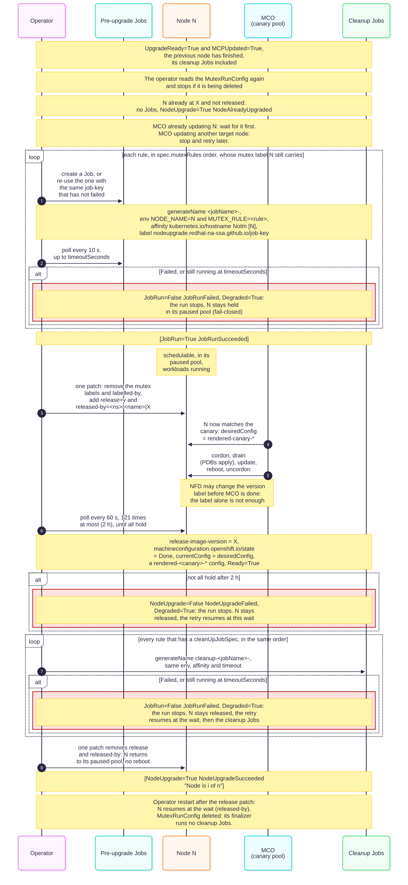

# Writing MutexRule Jobs

This guide is for the application and platform teams who write the Jobs that the operator runs before and after each
node's upgrade. It shows how to write, test and debug them. The rules the operator follows are in
[The Job contract](USAGE.md#the-job-contract) in the user guide, and the terms used here (held, released, run, retry
and others) are in its [Glossary](USAGE.md#glossary).

The examples use the names of the [Quick start](USAGE.md#quick-start): the operator namespace
`node-upgrade-mutex-operator`, the MutexRunConfig `workers`, the MutexRule `label-node` and the canary pool `canary`.

## Contents

- [Who does what](#who-does-what)
- [When your Jobs run](#when-your-jobs-run)
- [The state of the node](#the-state-of-the-node)
- [What your Job receives](#what-your-job-receives)
- [Re-use, failure, timeout and retry](#re-use-failure-timeout-and-retry)
- [Namespace, ServiceAccount and RBAC](#namespace-serviceaccount-and-rbac)
- [Recommended JobSpec settings](#recommended-jobspec-settings)
- [Worked examples](#worked-examples)
- [Test your Job before an upgrade](#test-your-job-before-an-upgrade)
- [Debug a Job during a run](#debug-a-job-during-a-run)
- [Pitfalls](#pitfalls)

## Who does what

A MutexRule holds two JobSpecs: `jobSpec`, run for each target node before its upgrade, and the optional
`cleanUpJobSpec`, run after it. The operator only acts on MutexRules in its own namespace. Anyone who can write there
can run any Job in any namespace with any ServiceAccount, so only cluster administrators should have that right (see
[Security model](USAGE.md#security-model)). The work is therefore split:

| Task | Who |
| --- | --- |
| Create and edit the MutexRule in the operator namespace | cluster administrator |
| List the rule in `spec.mutexRules` of the MutexRunConfig. That order is the order in which the Jobs of a node run. | cluster administrator |
| Write the JobSpecs, choose the image, make the script safe to run more than once | Job author |
| Create the ServiceAccount and the RBAC the Jobs need, in `spec.jobNamespace`. The operator creates none of them. | Job author in an application namespace; a cluster administrator in the operator namespace |
| Test the Job before an upgrade, and watch it during one | Job author, with the cluster administrator |

`spec.jobNamespace` decides where the Jobs run:

| | The operator namespace (the default) | An application namespace |
| --- | --- | --- |
| How | leave `spec.jobNamespace` out | `spec.jobNamespace: <namespace>` |
| ServiceAccount and RBAC | created there by a cluster administrator | owned by the application team |
| Who can read the Jobs and their logs | those who can read the operator namespace | the application team |
| Clean-up | the MutexRunConfig owns the Jobs: deleting it deletes them, logs included | nothing owns them (ansible-operator marks them with `operator-sdk/primary-resource` annotations instead); only `ttlSecondsAfterFinished` removes them |
| Must exist | it does | before the MutexRule is created, or the rule reports `ValidConfig` `False` |

## When your Jobs run



In words, once the control plane has finished its upgrade and the pools are re-pointed, for one target node at a time:

1. The operator reads the MutexRunConfig again and stops if it is being deleted.
2. For each rule in `spec.mutexRules` order whose mutex label the node still carries, it creates a pre-upgrade Job in
   the rule's `spec.jobNamespace`, or re-uses one (see below), and checks it every 10 seconds, for up to
   `timeoutSeconds`. The pod never runs on that node. A Job that fails, or still runs when `timeoutSeconds` is up,
   stops the run: `JobRun` `False`, `Degraded` `True`, and the node stays held.
3. While these Jobs run, the node is schedulable, stays in its paused pool and runs its workloads.
4. One patch then releases the node: it removes the node's mutex labels and `labelled-by` annotation, and adds the
   release label and the `released-by` annotation.
5. The node now matches the canary pool. MCO cordons it, drains it (PodDisruptionBudgets apply), updates and reboots it,
   and uncordons it.
6. The operator checks the node every 60 seconds, at most 120 times (2 hours), until its
   `machineconfiguration.openshift.io/release-image-version` label shows the new version, MCO reports it `Done` on a
   rendered config of the canary, and it is `Ready`. The label alone is not enough: it can change before the reboot. If
   the time runs out: `NodeUpgrade` `False` (`NodeUpgradeFailed`), and the retry resumes at this wait.
7. For each rule that has a `cleanUpJobSpec`, in the same order, it creates a cleanup Job, with the same checks and
   timeout.
8. One patch removes the release label and `released-by`. The node goes back to its paused pool without a reboot, and
   the next node's turn begins.

If the operator restarts after step 4, it resumes the node at step 6. If the MutexRunConfig is deleted, the reconcile
that is working on a node still finishes it, with its cleanup Jobs, and step 1 of the next node stops the run. The
finalizer that then restores the pools runs no Jobs: a node that is still released at that point, for example after
its upgrade wait timed out in an earlier reconcile, gets no cleanup Jobs. A node that already runs the new version
gets no Jobs.

| What | When | Where it is set |
| --- | --- | --- |
| The operator notices the upgrade and pauses the target pools | at its next reconcile, at most 10 minutes after the upgrade starts, unless another MutexRunConfig is working through its nodes | `reconcilePeriod` in `watches.yaml` |
| The first node's pre-upgrade Jobs start | at the first reconcile after the control plane has finished (ClusterVersion `status.history[0]` is `Completed` for the new version), normally within 10 minutes; when the canary has nodes of its own, also at least 5 minutes after they were labelled | `roles/mutexrunconfig` |
| Each Job is checked | every 10 seconds, for up to `timeoutSeconds` (default 3600) per attempt | `mutexrunconfig_job_poll_delay`, the MutexRule |
| The node's upgrade is checked | every 60 seconds, at most 120 times (2 hours) | `mutexrunconfig_node_upgrade_delay`, `_retries` |
| The cleanup Jobs start | up to about 60 seconds after the node is upgraded and `Ready` | the 60-second check |
| The next node's pre-upgrade Jobs start | right after the previous node is back in its pool, in the same reconcile | |
| A retry after a failure | after a few milliseconds at first, then doubling, up to about 17 minutes apart | the controller-runtime backoff |

The defaults are in [roles/mutexrunconfig/defaults/main.yml](../roles/mutexrunconfig/defaults/main.yml), built into
the operator image. [Timings](USAGE.md#timings) in the user guide explains the 5-minute wait. One reconcile works
through all target nodes, so the Jobs of the last node can run hours after the upgrade started.

## The state of the node

| Moment | The node | Its workloads |
| --- | --- | --- |
| Pre-upgrade Jobs run | Schedulable, in its paused target pool, normally still on the old version. It carries one mutex label `mutexrule.nodeupgrade.redhat-na-ssa.github.io/<rule>.<namespace>` per rule and the `labelled-by` annotation. | running |
| After the last pre-upgrade Job | Released: in the canary. MCO cordons, drains, updates, reboots and uncordons it. | evicted by the drain |
| Cleanup Jobs run | `Ready`, schedulable and on the new version, still in the canary (its `currentConfig` is `rendered-canary-<hash>`), with the release label and `released-by` | new pods can be scheduled on it |
| After the cleanup Jobs | Back in its paused target pool, with no reboot. It keeps the canary's rendered config until the pool is unpaused at the end of the run. | normal |

What follows for your Jobs:

- **Leave cordon and drain to MCO.** MCO cordons and drains the node right after its release. A pre-upgrade Job that
  cordons the node takes its capacity away earlier, and if a later rule's Job fails, the node stays cordoned for as long
  as the run is stopped, because a held node is never released to MCO.
- **Let the drain finish.** If a PodDisruptionBudget blocks the drain, the node does not finish its upgrade within the
  2-hour wait, and the run stops with `NodeUpgrade` `False` (`NodeUpgradeFailed`). A pre-upgrade Job can make room,
  for example by moving a replica, or wait until the application can lose a pod, as
  [job-wait-for-app.yaml](../sample-manifests/job-wait-for-app.yaml) does.
- **Do not assume the old version.** When MCO was already updating a node before the pools were paused, the operator
  waits for that update to finish and then still runs the node's pre-upgrade Jobs, on a node that may already run the
  new version.

## What your Job receives

Your JobSpec in the MutexRule (from [job-example.yaml](../sample-manifests/job-example.yaml), shortened):

```yaml
spec:
  jobName: label-node
  timeoutSeconds: 300
  jobSpec:
    backoffLimit: 2
    activeDeadlineSeconds: 240
    template:
      spec:
        serviceAccountName: mutex-node-labeler
        restartPolicy: Never
        containers:
          - name: oc
            image: registry.redhat.io/openshift4/ose-cli-rhel9:latest
            command: [oc, label, node, $(NODE_NAME), example.com/pre-upgrade-done=true, --overwrite]
```

The Job the operator creates from it for node `worker-1`, during an upgrade to 4.21.23, for MutexRunConfig `workers`:

```yaml
apiVersion: batch/v1
kind: Job
metadata:
  generateName: label-node-                  # cleanup Jobs: cleanup-label-node-
  namespace: node-upgrade-mutex-operator     # spec.jobNamespace, by default the MutexRule's namespace
  labels:
    nodeupgrade.redhat-na-ssa.github.io/job-key: <40 hex characters>
  annotations:
    nodeupgrade.redhat-na-ssa.github.io/mutexrunconfig: node-upgrade-mutex-operator/workers
    nodeupgrade.redhat-na-ssa.github.io/mutexrule: node-upgrade-mutex-operator/label-node
    nodeupgrade.redhat-na-ssa.github.io/node: worker-1
    nodeupgrade.redhat-na-ssa.github.io/phase: pre                 # cleanup for cleanup Jobs
    nodeupgrade.redhat-na-ssa.github.io/desired-version: 4.21.23
  ownerReferences:                           # only in the MutexRunConfig's namespace
    - apiVersion: nodeupgrade.redhat-na-ssa.github.io/v1alpha1
      kind: MutexRunConfig
      name: workers
      uid: <uid of the MutexRunConfig>
spec:
  backoffLimit: 2
  activeDeadlineSeconds: 240
  template:
    spec:
      serviceAccountName: mutex-node-labeler
      restartPolicy: Never
      containers:
        - name: oc
          image: registry.redhat.io/openshift4/ose-cli-rhel9:latest
          command: [oc, label, node, $(NODE_NAME), example.com/pre-upgrade-done=true, --overwrite]
          env:                               # appended to every container and initContainer
            - name: NODE_NAME
              value: worker-1
            - name: MUTEX_RULE
              value: label-node
      affinity:
        nodeAffinity:
          requiredDuringSchedulingIgnoredDuringExecution:
            nodeSelectorTerms:               # added to every term, or one new term
              - matchExpressions:
                  - key: kubernetes.io/hostname
                    operator: NotIn
                    values:
                      - worker-1
```

Everything else in your JobSpec is kept as it is: other env entries, pod affinity and anti-affinity, preferred node
affinity, tolerations, volumes. The environment follows these rules:

| Variable | Value | Notes |
| --- | --- | --- |
| `NODE_NAME` | the node being upgraded, in the pre-upgrade and in the cleanup Job | Never the node the pod runs on. It replaces an entry of the same name, such as a downward-API `NODE_NAME` from `spec.nodeName`: give that one another name. |
| `MUTEX_RULE` | the MutexRule's name | It replaces an entry of the same name. |

Use `$(NODE_NAME)` in `command` and `args`, which Kubernetes expands before the container starts, or `$NODE_NAME` in a
shell script. Inside your own env values `$(NODE_NAME)` stays as it is: Kubernetes expands only variables defined
earlier in the list, and the operator's entries come last.

**What your pod is not told.** The phase, the target version and the MutexRunConfig are annotations on the Job, not on
the pod. To get them:

- The phase: set your own variable in each JobSpec, for example `PHASE=pre` in `jobSpec` and `PHASE=cleanup` in
  `cleanUpJobSpec`, as [job-wait-for-app.yaml](../sample-manifests/job-wait-for-app.yaml) does.
- The target version: read `oc get clusterversion version -o jsonpath='{.status.desired.version}'`. The
  ServiceAccount then needs `get` on `clusterversions` (`config.openshift.io`), which takes a ClusterRole.
- Any of them: read the Job's own annotations. Pass the Job's name to the pod with the downward API (`fieldRef`
  `metadata.labels['job-name']`, the label the Job controller puts on its pods), give the ServiceAccount `get` on
  `jobs` in `jobNamespace`, and run for example
  `oc get job "$JOB_NAME" -o jsonpath='{.metadata.annotations.nodeupgrade\.redhat-na-ssa\.github\.io/desired-version}'`.

## Re-use, failure, timeout and retry



In words:

1. A Job is needed for one node, one rule and one phase (pre-upgrade or cleanup).
2. Its key, the `job-key` label, is a SHA-1 of the MutexRunConfig, the node, the rule's namespace and name, the phase
   and the target version. The JobSpec is not part of it.
3. The operator lists the Jobs with that key in `jobNamespace`. If one has not failed, it re-uses it: a `Complete` Job
   counts as done and is not run again, even after the MutexRule was edited, and a running one is waited for.
   Otherwise it creates a new Job.
4. It checks the Job every 10 seconds:
   - `Complete`: it moves on to the next rule, releases the node or returns it to its pool.
   - `Failed` (for example `backoffLimit` reached, or `activeDeadlineSeconds` passed): `JobRun` `False`, `Degraded`
     `True`, the pools stay paused, and the failed Job is kept. The retry creates a new Job.
   - Still running when `timeoutSeconds` is up: `JobRun` `False` with "did not finish within ...s (timeoutSeconds)".
     The Job keeps running, and the retry waits for the same Job again. Setting `activeDeadlineSeconds` below
     `timeoutSeconds` breaks this loop.
5. A Job whose pods are never created (a missing ServiceAccount, an SCC denial) looks like a running Job. A Job deleted
   before it is re-used (by its TTL or by hand) is replaced by a new one. Deleting the MutexRunConfig deletes the Jobs
   in its own namespace, with their logs.

What this means for your Job:

- **`timeoutSeconds` is not a kill switch.** It only limits how long the operator waits in one attempt. Bound the Job
  itself with `activeDeadlineSeconds`.
- **Your Job can run more than once for the same node.** The Job controller re-runs a failed pod up to `backoffLimit`,
  every retry after a failure starts a new Job, and a new OpenShift version gives the Jobs a new key. Make every step
  safe to repeat.
- **A Complete Job is final for that node, rule, phase and version.** To run it again, for example after fixing the
  MutexRule, delete it.
- **Jobs are looked up again only while their node is processed.** If `ttlSecondsAfterFinished` deletes a `Complete`
  pre-upgrade Job before its node is released, for example while a later rule keeps failing, it runs again. Use a day or
  more, and always set it when `jobNamespace` is not the operator namespace, because nothing else deletes those Jobs.
- **Save the logs before an abort.** Deleting the MutexRunConfig deletes its Jobs in its namespace.

The situations table in [The Job contract](USAGE.md#the-job-contract) lists what the operator does with your Job in
each case.

## Namespace, ServiceAccount and RBAC

The operator creates no namespace, ServiceAccount or RBAC for the Jobs. A pod runs as the `serviceAccountName` of its
template, or as `default` when it sets none. Give the rights to a ServiceAccount of its own, never to `default`: every
pod in the namespace that sets no ServiceAccount would get them.

A Job that acts on nodes needs a ClusterRole, because nodes are cluster-scoped. From
[job-example.yaml](../sample-manifests/job-example.yaml), which only labels the node:

```yaml
apiVersion: rbac.authorization.k8s.io/v1
kind: ClusterRole
metadata:
  name: mutex-node-labeler
rules:
  - apiGroups: [""]
    resources: [nodes]
    verbs: [get, patch]
```

A Job that checks an application needs only a Role in the application's namespace. From
[job-wait-for-app.yaml](../sample-manifests/job-wait-for-app.yaml), with its ServiceAccount and RoleBinding in
`my-app`:

```yaml
apiVersion: rbac.authorization.k8s.io/v1
kind: Role
metadata:
  name: mutex-wait-for-app
  namespace: my-app
rules:
  - apiGroups: [apps]
    resources: [deployments]
    verbs: [get, list, watch]
```

**Security context.** The samples set this on every container. The `restricted-v2` SCC admits it, so the Jobs need no
extra SCC:

```yaml
securityContext:
  allowPrivilegeEscalation: false
  capabilities:
    drop: [ALL]
  seccompProfile:
    type: RuntimeDefault
```

A Job that must act on the node itself, for example with `oc debug node/$NODE_NAME`, needs the right to run a
privileged pod on that node, which equals root on it. Prefer actions through the API.

**Images.** `registry.redhat.io` images are pulled with the cluster's global pull secret. For another registry that
needs credentials, add `imagePullSecrets` to the pod template and create the secret in `jobNamespace`. In a
disconnected cluster, mirror the image and add an ImageDigestMirrorSet (for a digest) or an ImageTagMirrorSet (for a
tag), or use the cluster's own CLI image stream,
`image-registry.openshift-image-registry.svc:5000/openshift/cli:latest`, when the internal registry is enabled.

**Small clusters.** The pod never runs on the node it prepares. When the only other nodes are tainted, for example
when they are control-plane nodes, add tolerations to the pod template:

```yaml
tolerations:
  - key: node-role.kubernetes.io/master
    operator: Exists
    effect: NoSchedule
  - key: node-role.kubernetes.io/control-plane
    operator: Exists
    effect: NoSchedule
```

## Recommended JobSpec settings

| Setting | Value | Why |
| --- | --- | --- |
| `template.spec.restartPolicy` | `Never` | Each attempt gets its own pod and log, and `podFailurePolicy` requires it. |
| `backoffLimit` | 2 or more | One failed pod is retried before the whole Job fails and stops the run. |
| `podFailurePolicy` | `Ignore` for the pod condition `DisruptionTarget` | Other pools and the canary's own nodes upgrade at the same time. A pod evicted by their drain should not count against `backoffLimit`. |
| `activeDeadlineSeconds` | below `timeoutSeconds`, for example 60 seconds below | The Job fails by itself before the operator stops waiting, so the retry starts a new Job instead of waiting for a hung one again. It also ends a Job whose pods never start. |
| `ttlSecondsAfterFinished` | 86400 (a day) or more | Removes old Jobs. A shorter value can delete a `Complete` Job that the operator still re-uses. Required in practice when `jobNamespace` is not the operator namespace. |
| `template.spec.tolerations` | only when needed | On small clusters, see above. |
| `nodeName`, or a node selector on `kubernetes.io/hostname` | never for the node being upgraded | The operator excludes that node, so such a pod can never run. |

In a JobSpec:

```yaml
jobSpec:
  backoffLimit: 2
  activeDeadlineSeconds: 240        # with timeoutSeconds: 300
  ttlSecondsAfterFinished: 86400
  podFailurePolicy:
    rules:
      - action: Ignore
        onPodConditions:
          - type: DisruptionTarget
  template:
    spec:
      restartPolicy: Never
      serviceAccountName: <your ServiceAccount>
      containers:
        - name: step
          image: <your image>
```

Keep `jobName` at 49 characters or fewer. The API server cuts a `generateName` to 58 characters, so a longer
`jobName` makes the cleanup Jobs' names lose the end of `cleanup-<jobName>-`. The rule's own name must not contain
`.`, and `<name>.<namespace>` must be at most 63 characters, because the node label is
`mutexrule.nodeupgrade.redhat-na-ssa.github.io/<name>.<namespace>`. The MutexRule's `ValidConfig` does not check this;
the MutexRunConfig refuses such a rule.

## Worked examples

- [job-example.yaml](../sample-manifests/job-example.yaml): MutexRule `label-node`, the rule of the Quick start. Its
  pre-upgrade Job labels the node, its cleanup Job removes the label. It shows a ServiceAccount with a node ClusterRole,
  the recommended settings and commands that are safe to repeat: removing a label the node does not have only prints a
  message, so the cleanup Job also succeeds when the pre-upgrade Job never ran.
- [job-wait-for-app.yaml](../sample-manifests/job-wait-for-app.yaml): MutexRule `wait-for-app`. Its Jobs run in the
  application's namespace and wait with `oc rollout status` until every replica of a Deployment is available again,
  before each node is drained and after it is back. It shows a Role in the application namespace, `PHASE` set per
  JobSpec and `activeDeadlineSeconds` as the only time limit. Edit the namespace and Deployment before applying it.

[sample-manifests/README.md](../sample-manifests/README.md) gives the order in which to apply the samples.

## Test your Job before an upgrade

`ValidConfig` `True` on the MutexRule means the API server accepted both JobSpecs in a server-side dry-run create of a
Job in `jobNamespace`, sent as the operator. That proves the Job schema is valid, the namespace exists and the
operator may create Jobs there. No pod is created, so it does not prove that the ServiceAccount exists, that the pod
passes its SCC and Pod Security admission, that the image can be pulled, that pod quota allows it, that the
ServiceAccount has the rights your command needs, or that the pod can be scheduled.

To check those, render the Job as the operator would and run it once. Set the rule, a node, and the phase (`pre` for
`jobSpec`, `cleanup` for `cleanUpJobSpec`):

```sh
rule=label-node
node=<node name>
phase=pre
oc get mutexrule "$rule" -n node-upgrade-mutex-operator -o json | jq --arg node "$node" --arg phase "$phase" '
  def addenv($rule): (.env // []) as $env
    | .env = ([$env[] | select(.name != "NODE_NAME" and .name != "MUTEX_RULE")]
              + [{name: "NODE_NAME", value: $node}, {name: "MUTEX_RULE", value: $rule}]);
  .metadata.name as $rule | .spec as $s
  | {apiVersion: "batch/v1", kind: "Job",
     metadata: {generateName: ((if $phase == "pre" then "" else "cleanup-" end) + $s.jobName + "-test-"),
                namespace: ($s.jobNamespace // .metadata.namespace)},
     spec: ((if $phase == "pre" then $s.jobSpec else $s.cleanUpJobSpec end)
       | .template.spec.containers |= map(addenv($rule))
       | if (.template.spec.initContainers // []) != [] then .template.spec.initContainers |= map(addenv($rule)) else . end
       | .template.spec.affinity.nodeAffinity.requiredDuringSchedulingIgnoredDuringExecution.nodeSelectorTerms |=
           (if (. // []) == [] then [{}] else . end
            | map(.matchExpressions = ((.matchExpressions // []) + [{key: "kubernetes.io/hostname", operator: "NotIn", values: [$node]}]))))}' > test-job.json
```

The Job has the env and node affinity the operator adds, but no `job-key` label, so the operator never re-uses it,
and its name contains `-test-`. Then:

1. `oc create --dry-run=server -o yaml -f test-job.json` validates it on the server, as you rather than as the
   operator. It still creates no pod.
2. `oc create -f test-job.json` runs it. **This is a real run that acts on the node you named**, so use a
   non-production cluster or a node where that is safe. Follow it with `oc get job -n <jobNamespace>` and
   `oc logs -n <jobNamespace> job/<job>`, and check the events if it does not start (see below).
3. Delete it afterwards: `oc delete job <job> -n <jobNamespace>`.

For the samples in this repository, and for JobSpecs with initContainers, their own `NODE_NAME` and `MUTEX_RULE` entries
and several node selector terms, the snippet's `spec` was compared with the one
[07-run-job.yml](../roles/mutexrunconfig/tasks/07-run-job.yml) builds, and they are the same. It has not yet been run
with `--dry-run=server` against a cluster.

A rehearsal of the whole run is a real z-stream upgrade on a non-production cluster (see
[Before your first upgrade](USAGE.md#before-your-first-upgrade)).

## Debug a Job during a run

**Find the Jobs.** Only the `job-key` label is selectable; the node, phase and rule are annotations:

```sh
a='.metadata.annotations.nodeupgrade\.redhat-na-ssa\.github\.io'
oc get jobs -A -l nodeupgrade.redhat-na-ssa.github.io/job-key --sort-by=.metadata.creationTimestamp \
  -o custom-columns="NAMESPACE:.metadata.namespace,NAME:.metadata.name,NODE:$a/node,PHASE:$a/phase,RULE:$a/mutexrule,VERSION:$a/desired-version,SUCCEEDED:.status.succeeded,FAILED:.status.failed"
```

Replace `-A` with `-n <jobNamespace>` if you can read only that namespace.

**Read the logs and events:**

```sh
oc logs -n <jobNamespace> job/<job>
oc logs -n <jobNamespace> -l job-name=<job> --all-containers --prefix        # every pod of the Job
oc get events -n <jobNamespace> --field-selector involvedObject.kind=Job,involvedObject.name=<job>
oc describe pods -n <jobNamespace> -l job-name=<job>
```

A `FailedCreate` event on the Job means its pods are refused, for example because the ServiceAccount is missing or an
SCC denies the pod. `FailedScheduling` or an image pull error shows on the pods.

**Read what the operator reports** (a cluster administrator, in the operator namespace):

```sh
oc get mutexrunconfig workers -n node-upgrade-mutex-operator -o jsonpath='{range .status.conditions[*]}{.type}{"\t"}{.status}{"\t"}{.reason}{"\t"}{.message}{"\n"}{end}'
```

`JobRun` `False` (`JobRunFailed`) names the Job: "Jobs for `<node>` failed: `<phase>` Job `<namespace>/<job>` of
MutexRule `<namespace>/<rule>` for node `<node>`", where `<phase>` is `pre` or `cleanup`, followed by one of:

- "failed: ..." with the Job's own `Failed` message, for example "Job has reached the specified backoff limit" or "Job
  was active longer than specified deadline";
- "did not finish within `<N>`s (timeoutSeconds)", `<N>` being the rule's `timeoutSeconds`: the Job still runs, or
  its pods never started;
- "could not be read: ...": the Job is gone or cannot be read.

Its second line is "Node is `<i>` of `<n>`". `NodeUpgrade` `False` (`NodeUpgradeFailed`) is about the node's upgrade,
not your Job. The user guide has a runbook for each case: [A Job failed](USAGE.md#a-job-failed-jobrunfailed),
[A Job did not finish in time](USAGE.md#a-job-did-not-finish-in-time) and
[A Job's pods never start](USAGE.md#a-jobs-pods-never-start).

**Fix and retry:**

1. Fix the cause. If something is missing, such as the ServiceAccount or a RoleBinding, create it: the Job controller
   keeps trying to create the pods, so the same Job can still finish. If the JobSpec is wrong, the cluster
   administrator edits the MutexRule and checks that it reports `ValidConfig` `True` again.
2. If the Job has not failed (it still runs, or it is `Complete` but did the wrong thing), delete it:
   `oc delete job <job> -n <jobNamespace>`. Otherwise the retry re-uses it. A failed Job can stay: the retry starts a
   new one from the current MutexRule.
3. Wait for the retry, at most about 17 minutes, or start it now (see [Retry now](USAGE.md#retry-now)). Editing the
   MutexRule does not start one.

**Before an abort, save the logs.** Deleting the MutexRunConfig deletes its Jobs in the operator namespace:

```sh
ns=<jobNamespace>
for job in $(oc get jobs -n "$ns" -l nodeupgrade.redhat-na-ssa.github.io/job-key -o name); do
  oc logs -n "$ns" "$job" --all-containers > "${job#job.batch/}.log"
done
```

After an abort, the node in progress finishes first, with its Jobs. Then no more Jobs run: the remaining nodes
upgrade without their Jobs, and a node that is still released when the finalizer runs, for example because its
cleanup Job failed, loses its release label without its cleanup Jobs. Run that cleanup yourself if you need it, for
example with the snippet above and `phase=cleanup`. See [Abort a run](USAGE.md#abort-a-run).

## Pitfalls

- **"did not finish within ...s (timeoutSeconds)" on every retry.** The Job still runs. `timeoutSeconds` does not stop
  it, and each retry waits for the same Job. Set `activeDeadlineSeconds`; delete the Job to start over.
- **The Job's pods never start.** `ValidConfig` was `True`, but the pods are refused (a missing ServiceAccount, an SCC,
  quota) or cannot be scheduled. The Job never fails, so the operator treats it as running until `timeoutSeconds`.
  Check the events. `activeDeadlineSeconds` turns this into a failure as well.
- **`$(NODE_NAME)` appears literally.** It was used inside an env value. Use it in `command` or `args`, or `$NODE_NAME`
  in a shell script.
- **A tool that reads `NODE_NAME` gets the wrong node.** The operator replaces any `NODE_NAME` with the node being
  upgraded. Pass the pod's own node under another name.
- **The cleanup Job ran, but no pre-upgrade Job.** Cleanup Jobs run for every rule that has a `cleanUpJobSpec`.
  Pre-upgrade Jobs run only for rules whose mutex label the node still carries, which a rule added to the
  MutexRunConfig during a run, for example, does not have. Make the cleanup a no-op when there is nothing to undo.
- **The cleanup never ran.** An abort skips the cleanup Jobs of a node that is still released, for example after its
  cleanup Job failed, and every Job of the remaining nodes. Leave the application safe even without its cleanup.
- **The pre-upgrade Job found the node already upgraded.** MCO was updating that node before the pools were paused.
- **No Job ran for a node.** The node already ran the target version, so it was skipped (`NodeUpgrade` `True`,
  `NodeAlreadyUpgraded`).
- **A fix to the MutexRule had no effect.** A Job of the old JobSpec that has not failed is re-used. Delete it. The
  MutexRunConfig reads the MutexRule again only at its next reconcile.
- **The Job ran twice for the same node.** A retry after a failure, a deleted `Complete` Job, a pod retried within
  `backoffLimit`, or a new OpenShift version.
- **Cleanup Jobs do not match `cleanup-<jobName>-`.** `jobName` has more than 49 characters. Find them by the `phase`
  annotation.
- **The MutexRule reports `ValidConfig` `True`, but the MutexRunConfig refuses it.** Its name contains `.`, or
  `<name>.<namespace>` is longer than 63 characters.
- **The pods stay `Pending` on a small cluster.** No other node can take them. Add tolerations.
- **The logs are gone after an abort.** The Jobs in the operator namespace went with the MutexRunConfig. Save them
  first, or run the Jobs in an application namespace with a TTL.
- **The node's upgrade times out after the Jobs succeeded.** A PodDisruptionBudget can block MCO's drain.
