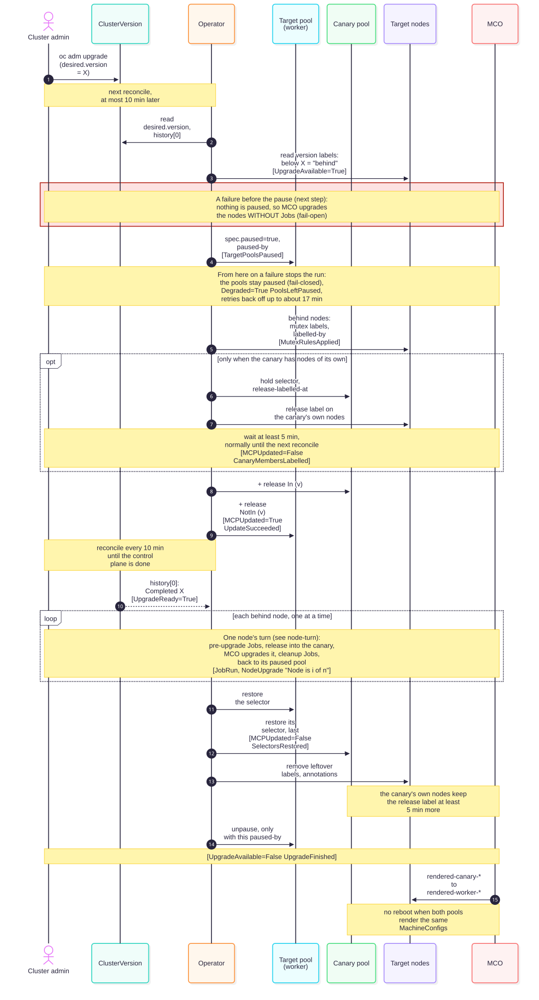

# OpenShift Node Upgrade Mutex Operator

During an OpenShift upgrade, this operator upgrades the worker nodes you choose one at a time and runs your Kubernetes
Jobs before and after each node. The Machine Config Operator (MCO) still cordons, drains, updates and reboots each
node: the operator only decides when each node may go. If a Job fails, the upgrade stops with the pools paused.

| Project | |
| --- | --- |
| Status | Alpha. The API is `v1alpha1` and may change. |
| Releases | Published to `ghcr.io/redhat-na-ssa` by the release workflow. Until the first release there (0.3.0-rc2), the catalog is empty: see [Install](#install). |
| OpenShift | Declared for 4.16 and later. Tested live on 4.21 z-stream upgrades only: see [tests/Scenarios.md](../tests/Scenarios.md). |
| License | [Apache License 2.0](../LICENSE) |
| Support | Best effort. Report problems at https://github.com/redhat-na-ssa/openshift-node-upgrade-mutex-operator/issues |


In words:

1. A cluster administrator creates three custom resources in the operator namespace (`node-upgrade-mutex-operator`).
   A **MutexRule** holds a Job template and an optional cleanup Job. A **MutexTarget** names MachineConfigPools. A
   **MutexRunConfig** lists the rules in order, the targets, and the canary pool. Only CRs in that namespace are acted
   on.
2. The operator pod runs on a control-plane node and reconciles every 10 minutes. It reads ClusterVersion `version`
   (`status.desired.version`, `status.history[0]`); it does not watch it.
3. When `oc adm upgrade` sets a desired version above a target node's version label, the operator pauses the target
   pools and changes the node selectors of the target pools and the canary pool.
4. A node moves into the canary pool, which is never paused and normally empty, only when the operator gives it the
   release label. MCO then drains, updates and reboots it there.
5. For one node at a time the operator runs your Jobs in `spec.jobNamespace`, never on that node, releases the node,
   waits for its upgrade, then runs your cleanup Jobs. Jobs are for application-level work, such as moving a replica,
   waiting for a quorum or calling an external system. The operator never deletes them.
6. Node Feature Discovery (NFD) and a sample MachineConfig keep the label
   `machineconfiguration.openshift.io/release-image-version` on every node, so the operator can tell which nodes are
   behind.

## Start here

| I want to | Read |
| --- | --- |
| decide whether it fits | [Is it for you?](#is-it-for-you), [Safety model](#safety-model), [Security model](#security-model) |
| install and set it up | [Quick start](#quick-start) |
| write the Jobs | [Writing MutexRule Jobs](JOBS.md), then [The Job contract](#the-job-contract) |
| watch an upgrade | [Watching a run](#watching-a-run) |
| fix a failed or stuck run | [Troubleshooting and recovery](#troubleshooting-and-recovery) |
| remove it | [Uninstall](#uninstall) |
| change or release the code | [DEVELOPMENT.md](DEVELOPMENT.md), [DESIGN.md](DESIGN.md) |
| take over the repository | [HANDOFF.md](HANDOFF.md) |

## Contents

* [How it works](#how-it-works)
* [Is it for you?](#is-it-for-you)
* [Safety model](#safety-model)
* [Security model](#security-model)
* [Quick start](#quick-start)
* [Prerequisites](#prerequisites)
* [Install](#install)
* [Set up a run](#set-up-a-run)
* [The Job contract](#the-job-contract)
* [Before your first upgrade](#before-your-first-upgrade)
* [Watching a run](#watching-a-run)
* [Troubleshooting and recovery](#troubleshooting-and-recovery)
* [Uninstall](#uninstall)
* [Reference](#reference)
* [Moving from 0.2.x](#moving-from-02x)
* [More information](#more-information)

## How it works



In words, for one MutexRunConfig and one OpenShift upgrade:

1. **Pause and hold.** At its next reconcile after `oc adm upgrade`, at most 10 minutes later, the operator sees that
   target nodes are behind the new version. It pauses the target pools and gives each node that is behind one mutex
   label per MutexRule (conditions `TargetPoolsPaused`, `MutexRulesApplied`).
2. **Re-point.** It changes the node selectors: the canary pool now selects only nodes with this run's release label,
   and each target pool selects its nodes without it (`MCPUpdated=True`). If the canary has nodes of its own, this
   step waits (see [Timings](#timings)).
3. **Wait for the control plane.** Nothing else happens until ClusterVersion `status.history[0]` is `Completed` for the
   new version (`UpgradeReady=True`).
4. **One node at a time.** For each node that is behind: its pre-upgrade Jobs run, one patch replaces its mutex labels
   with the release label, MCO upgrades it in the canary, the operator waits until it is done and `Ready`, the cleanup
   Jobs run, and the node goes back to its paused pool (`JobRun`, `NodeUpgrade` "Node is 2 of 5").
5. **Restore.** The original selectors come back (the canary last), the labels are removed, and the pools the operator
   paused are unpaused (`MCPUpdated=False SelectorsRestored`, `UpgradeAvailable=False UpgradeFinished`). The upgraded
   nodes switch to their own pool's rendered config, with no reboot when both pools render the same MachineConfigs.
6. **Settle.** Only when the canary has nodes of its own: a later reconcile removes their release label.

A failure before step 1 changes nothing, and MCO upgrades the pools normally, **without** Jobs. From step 1 on, a
failure stops the run with the pools paused, `Degraded=True PoolsLeftPaused`, and the operator retries. The
[Safety model](#safety-model) explains both.

### Glossary

| Term | Meaning | Label, annotation or field |
| --- | --- | --- |
| operator namespace | The namespace the operator runs in, `node-upgrade-mutex-operator` by default. Only CRs there are acted on. | the pod's `POD_NAMESPACE` |
| target pool | A MachineConfigPool listed in a MutexTarget. Its nodes are upgraded one at a time. | MutexTarget `spec.machineConfigPools` |
| canary pool | A pass-through pool, never paused and normally empty. Each target node passes through it while MCO upgrades it. It is **not** a test subset that is upgraded first. | MutexRunConfig `spec.canary.name` |
| the canary's own node | A node that is in the canary pool before a run. Not recommended: leave the canary empty. | matches the canary's selector, not a target node |
| behind | A target node whose version label is lower than the version the cluster is moving to. | node label `machineconfiguration.openshift.io/release-image-version`, ClusterVersion `status.desired.version` |
| mutex label | One label per MutexRule on a node that is behind. It records that the rule's pre-upgrade Job has not run yet. | `mutexrule.nodeupgrade.redhat-na-ssa.github.io/<rule>.<namespace>` |
| held | A target node that carries mutex labels. It stays in its paused pool. | mutex labels, annotation `nodeupgrade.redhat-na-ssa.github.io/labelled-by` |
| release label | Puts a node in the canary during a run. Its value is the SHA-1 of the MutexRunConfig's `<namespace>/<name>`. | `mutexrule.nodeupgrade.redhat-na-ssa.github.io/release` |
| released | A target node whose pre-upgrade Jobs are done. It is in the canary until its cleanup Jobs are done. | release label, annotation `nodeupgrade.redhat-na-ssa.github.io/released-by` |
| run | Everything one MutexRunConfig does for one OpenShift upgrade, from the pause to the restore. | |
| reconcile | One pass of the operator over a CR: every 10 minutes, after a spec change, or as a retry. One reconcile works through all nodes, so it can last hours. | |
| retry | A reconcile after a failed one, with a backoff of up to about 17 minutes. | |
| re-point | Changing the node selectors of the target pools and the canary for the run, and back. | `spec.nodeSelector.matchExpressions` |
| settle time | 300 seconds between a release label change and a selector change that depends on it. | see [Why some steps wait 5 minutes](#why-some-steps-wait-5-minutes) |

To compute a release label value: `printf '%s' 'node-upgrade-mutex-operator/workers' | sha1sum | cut -c1-40`. On
macOS use `shasum -a 1` instead of `sha1sum`.

## Is it for you?

### What it guarantees

Once the target pools are paused (see the [Safety model](#safety-model) for before that):

* It releases one target node at a time. The next node is released only after the previous one has finished its
  upgrade and its cleanup Jobs.
* A node is released only after its pre-upgrade Jobs have completed.
* After a failure it never unpauses a pool. The pools stay paused until the cause is fixed or you abort.
* It unpauses only pools whose `paused-by` annotation names its own MutexRunConfig. A pool you paused stays paused.
* It never deletes Jobs.

### Limitations

* Only a change of ClusterVersion `status.desired.version` starts a run. Ordinary MachineConfig, KubeletConfig or
  other MCO rollouts are not sequenced, and no Jobs run for them.
* EUS-to-EUS upgrades are not tested. With a MutexRunConfig in place, the workers would be upgraded at the
  intermediate hop. See [Residual risks](#residual-risks) for the procedure.
* No single-node (SNO) or compact three-node clusters, whose only nodes are control-plane nodes, and no hosted
  control planes, which have no MachineConfigPools.
* The operator pod needs a schedulable control-plane node.
* Job pods never run on the node they prepare, so another node must have room for them.
* The `master` pool is not supported as a target pool.
* There is no per-node skip and no suspend switch. The only way to stop a run is to [abort it](#abort-a-run).
* One operator per cluster, one MutexRunConfig per canary pool, and no target pool shared between MutexRunConfigs.
* MutexRunConfigs are handled one at a time (see [One MutexRunConfig at a time](#one-mutexrunconfig-at-a-time)).

### What it costs

* **Setup:** the NFD operator and a MachineConfig that publishes the version label. Applying that MachineConfig
  reboots every worker once.
* **Time:** nodes are upgraded one at a time. A pool takes about one node upgrade plus your Jobs' runtime per node, and
  its pool stays paused for all that time.
* **Jobs:** you write and maintain them, with their ServiceAccount and RBAC.

### Tested environments

* Automated: lint, bundle and catalog validation, and a molecule end-to-end test on kind in CI, which simulates MCO.
* Live: one small OpenShift 4.21 cluster through three z-stream upgrades, the last two with the design this release
  ships.
* Not yet tested live: a minor-version upgrade, the low end of 4.16+, a stuck node, the manual restore as written, a
  full run on a custom pool, and disconnected clusters. Details: [tests/Scenarios.md](../tests/Scenarios.md).

## Safety model

### When it protects you

| Phase | How you can tell | What a failure does |
| --- | --- | --- |
| Before the target pools are paused | `Paused` is `False` | **Fail-open.** The operator changes nothing, and MCO upgrades the pools normally, **without** Jobs. This covers a validation failure, a missing version label, a failed upgrade check, and the time until the operator notices the upgrade. |
| While the pools are paused | `Paused` and `Upgrade` are `True` | **Fail-closed.** The run stops, the pools stay paused, `Degraded=True PoolsLeftPaused`, and the operator retries. No node is released without its Jobs. |
| After an abort | the MutexRunConfig is deleted | **Unprotected.** MCO upgrades the remaining nodes **without** Jobs, as many at a time as each pool's `maxUnavailable` allows. |

### Check before every upgrade

Before `oc adm upgrade`, every MutexRunConfig must show `ConfigValidated=True` and `NodeVersionsKnown=True`:

```sh
oc get mutexrunconfig -n node-upgrade-mutex-operator
oc get mutexrunconfig <name> -n node-upgrade-mutex-operator \
  -o jsonpath='{range .status.conditions[*]}{.type}{"\t"}{.status}{"\t"}{.reason}{"\n"}{end}'
```

Expected: `VALIDATED` `True` and `DEGRADED` `False`. In the second list, `ConfigValidated True`,
`NodeVersionsKnown True` and `UpgradeChecked True`. If one is not, fix it first, or the upgrade runs without Jobs.

### Pausing the pools yourself

To close the fail-open window, pause the target pools yourself before `oc adm upgrade`:

```sh
oc patch mcp worker --type merge -p '{"spec":{"paused":true}}'
```

The operator uses a pool that is already paused as it is, and still releases its nodes one at a time through the
canary. It never unpauses such a pool, so unpause it yourself after the run (`"paused":false`). Do not pause the
canary. This has not been tested on a live cluster.

### Trust assumptions

* **ClusterVersion** `status.desired.version` and `status.history[0]` tell the operator where the cluster is going and
  when the control plane is done.
* **The node version label** `machineconfiguration.openshift.io/release-image-version` decides which nodes are behind.
  You maintain it (see [The release version label](#the-release-version-label)), and anyone who may patch nodes can
  change it. A node whose label already shows the new version is skipped (`NodeAlreadyUpgraded`), and MCO upgrades it
  **without** Jobs when its pool is unpaused at the end.
* **MCO's node annotations** `machineconfiguration.openshift.io/state`, `currentConfig` and `desiredConfig`, and the
  node's `Ready` condition, tell the operator that a node has finished its upgrade.

### Residual risks

| Risk | Trigger | Impact | Mitigation | Tested |
| --- | --- | --- | --- | --- |
| A second upgrade during a run | `oc adm upgrade` again before every MutexRunConfig shows `Upgrade` `False` | Other MutexRunConfigs are not reconciled until the running one ends, so they do not pause their pools, and MCO can upgrade those nodes **without** Jobs. | Wait for the end of every run. See [the runbook](#a-second-openshift-upgrade-started-during-a-run). | no |
| Detection up to 10 minutes late | ClusterVersion is not watched | MCO can start updating a target node before the pause. That node finishes its update first; its pre-upgrade Jobs run after it. | [Pause the pools yourself](#pausing-the-pools-yourself). The control plane normally takes longer than 10 minutes. | no |
| APIService flaps early in the upgrade | An APIService is not `Available` for 3 checks 10 s apart | Before the pause: nothing is paused, so this is fail-open. During a run: the run stops with the pools paused. | Fix the APIService; pause the pools yourself. | no |
| An API outage longer than the settle time | An outage starts right after the canary's own nodes get the release label | One of the canary's own nodes can pass through the `worker` pool once, when `worker` is not a target pool. | Keep the canary empty. | no |
| The finalizer's single pass | Deleting a MutexRunConfig while MCO's view of the pools lags | The same as the row above. | Keep the canary empty. | no |
| Admin-paused pools and EUS | An EUS-to-EUS upgrade keeps the worker pools paused across two hops | The operator releases the nodes through the unpaused canary after the first hop, so workers upgrade to the intermediate version. | Delete the MutexRunConfig before the procedure. After the last control-plane hop, unpausing the pools as the procedure says runs no Jobs. To run them, unpause only the canary, create the MutexRunConfig, and unpause the target pools yourself after its run (expected to work, untested). | no |
| Nodes added or removed during a run | A MachineSet or the autoscaler | A deleted target node stops the run ("Node `<name>` was not found.") until its MutexTarget drops it at its next reconcile. What happens to an added node is unknown. | Do not scale the target pools during an upgrade. | no |
| Long pauses | Many nodes, or a failure nobody fixes | Paused pools get no other MachineConfig changes. OpenShift advises against keeping pools paused for long. | Watch `Degraded`; fix or abort promptly. | n/a |
| A stale version label | NFD or the MachineConfig not running, or a label set by hand | A label that already shows the new version: the node is upgraded **without** Jobs at the end. A label that lags: the node wait times out after 2 hours. | [Check before every upgrade](#check-before-every-upgrade); `oc get nodes -L machineconfiguration.openshift.io/release-image-version`. | the label timing, live |

The states of a run, and where a failure keeps the pools paused, are shown in [Watching a run](#watching-a-run).

## Security model

### Who controls the operator

Anyone who can create or edit MutexRules, MutexTargets or MutexRunConfigs **in the operator namespace** can pause
MachineConfigPools, relabel nodes, and run Jobs in any namespace with any ServiceAccount there. Treat write access to
that namespace as cluster-admin. OLM creates `admin`, `edit` and `view` aggregated roles for these CRDs, so every user
with `admin` or `edit` in the operator namespace has that access. CRs in other namespaces are ignored for this reason.
Check who has it: `oc adm policy who-can create mutexrunconfigs -n node-upgrade-mutex-operator`.

### Job ServiceAccounts

A MutexRule's Jobs run in its `spec.jobNamespace` with the ServiceAccount set in its pod template. Any namespace and
any ServiceAccount are accepted, and the operator may create Jobs in every namespace. A writer of the operator
namespace can therefore run code with the rights of any ServiceAccount in the cluster.

### Blast radius

The operator's own ServiceAccount may patch **any field of any node** (labels, taints, `spec.unschedulable`), patch
**every** MachineConfigPool, `master` included, and create Jobs in every namespace. RBAC cannot narrow these to the
keys the operator uses. It has no access to Secrets, ConfigMaps, Pods or workloads. The full list is in
[Permissions](#permissions).

### Templated CR values

`watches.yaml` does not set ansible-operator's `markUnsafe`, so string values in the CRs may be evaluated as Ansible
templates inside the operator pod. Two consequences: a value with `{{` in it, such as a Go template in a Job's
arguments, may be rendered or rejected; and a writer of the operator namespace may be able to run code in the operator
pod. This has not been verified with a test.

### Metrics authentication

The metrics endpoint needs a bearer token whose identity may `get` `/metrics`. See [Metrics](#metrics).

### Supply chain

The release bundle refers to the operator image by digest. The base images (`ansible-operator`, `opm`) and the Ansible
collections are pinned by version, not by digest. The images are not signed and have no SBOM or provenance
attestation.

## Quick start

Each step has a command and what you should see. The sample files are in
[sample-manifests/](../sample-manifests/README.md). Never apply that directory as a whole.

1. **Check the fit.** `oc get clusterversion version -o jsonpath='{.status.desired.version}'` and `oc get mcp`.
   Expected: 4.16 or later, and a `worker` pool with your worker nodes.
2. **Install NFD.** Install the Node Feature Discovery operator from OperatorHub into `openshift-nfd`, then
   `oc apply -f sample-manifests/nodefeaturediscovery.yaml`. If the cluster already runs NFD, see
   [The release version label](#the-release-version-label) instead.
3. **Publish the version label.** **This reboots every worker, as many at a time as the pool's `maxUnavailable`
   allows. Do it in a maintenance window.** `oc apply -f sample-manifests/machineconfig.yaml`, then
   `oc get mcp worker -w`. Expected: `UPDATED` `True` and `UPDATING` `False` once every worker has rebooted.
4. **Check the label.** `oc get nodes -L machineconfiguration.openshift.io/release-image-version`. Expected: the
   cluster's version on every target node.
5. **Create the canary pool.** `oc apply -f sample-manifests/canary-mcp.yaml`, then `oc get mcp canary`. Expected:
   `MACHINECOUNT` `0`.
6. **Install the operator.** `oc apply -f sample-manifests/catalogsource.yaml` (until 0.3.0 is released, change its
   tag first, see [Catalog and versions](#catalog-and-versions)), then
   `oc apply -f sample-manifests/operator-install.yaml` (namespace, OperatorGroup, and a Subscription with `Manual`
   approval). Approve the InstallPlan:

   ```sh
   oc get installplan -n node-upgrade-mutex-operator
   oc patch installplan <name> -n node-upgrade-mutex-operator --type merge -p '{"spec":{"approved":true}}'
   ```

   Expected: `oc get csv -n node-upgrade-mutex-operator` shows the operator's CSV `Succeeded`. If no InstallPlan
   appears, read [Install](#install) first: the catalog may have no release yet.
7. **Create a MutexRule.** `oc apply -f sample-manifests/job-example.yaml` (ServiceAccount, ClusterRole, binding and
   the MutexRule `label-node`, whose Jobs label each node before its upgrade and remove the label after it). Expected:
   `oc get mutexrule -n node-upgrade-mutex-operator` shows `label-node` with `VALIDCONFIG` `True`.
8. **Create the MutexTarget and MutexRunConfig.** `oc apply -f sample-manifests/mutex-target-and-runconfig.yaml`.
   Expected: `oc get mutextarget -n node-upgrade-mutex-operator` shows the worker nodes under `NODES` and
   `VALIDCONFIG` `True`, and `oc get mutexrunconfig -n node-upgrade-mutex-operator` shows `VALIDATED` `True`, `UPGRADE`
   `False`, `PAUSED` `False`, `DEGRADED` `False`.
9. **Before each upgrade,** run the [check](#check-before-every-upgrade).
10. **Optional:** rehearse on a non-production cluster (see [Before your first upgrade](#before-your-first-upgrade)).

Then replace `label-node` with your own Jobs: see [Writing MutexRule Jobs](JOBS.md).

## Prerequisites

### OpenShift version and platform

* OpenShift 4.16 or later (Kubernetes 1.29 or later). The operator reads `config.openshift.io/v1` ClusterVersion and
  patches `machineconfiguration.openshift.io/v1` MachineConfigPools, so it does not work on plain Kubernetes.
* Worker nodes in MachineConfigPools, running RHCOS (the sample label script needs `rpm-ostree`).
* A schedulable control-plane node for the operator pod. The pod has a required node affinity for
  `node-role.kubernetes.io/control-plane` and tolerates the control-plane taints, so it never runs on a worker it is
  about to release. It requests 10m CPU and 256Mi memory.
* On a cluster with a single control-plane node, the operator pod restarts during each API outage of an upgrade,
  because it loses its leader election. That is expected; the run resumes after each restart.

### The release version label

The operator compares the version each target node runs with the version the cluster is moving to. OpenShift has no
per-node version label, so you maintain one:

```
machineconfiguration.openshift.io/release-image-version=<x.y.z>     (for example 4.16.4)
```

The samples do it with NFD. A MachineConfig installs a script and a timer that, every minute, write the release
version of the config the node has booted into to an NFD feature file. NFD publishes it as the label. The script
publishes a version only when the booted OS image is the one that config names. When a release keeps the same OS
image, the label can change shortly before the node reboots, which is why the operator also waits for MCO and `Ready`
before it counts a node as upgraded.

1. Install the Node Feature Discovery operator from OperatorHub into `openshift-nfd`.
2. Apply [nodefeaturediscovery.yaml](../sample-manifests/nodefeaturediscovery.yaml). If the cluster already runs NFD,
   keep its NodeFeatureDiscovery instead, and make sure its `workerConfig` enables the local source:
   `core.labelSources` and `core.featureSources` (and the deprecated `core.sources`, if set) are unset or list `local`
   or `all`.
3. **Applying the MachineConfig reboots every node of every pool that renders the worker MachineConfigs, as many at a
   time as each pool's `maxUnavailable` allows. Do it in a maintenance window, before you rely on the operator.**
   Apply [machineconfig.yaml](../sample-manifests/machineconfig.yaml) and wait until `oc get mcp` shows `UPDATED`
   `True` for every pool.
4. Verify: `oc get nodes -L machineconfiguration.openshift.io/release-image-version` shows the cluster's version on
   every target node, within about 2 minutes of each reboot.

The check fails closed for this label: if a target node has no label, or a value that is not a semantic version, the
MutexRunConfig reports `NodeVersionsKnown=False` and nothing is paused, labelled or run. That also means no Jobs run
(see [When it protects you](#when-it-protects-you)).

### The canary pool



In words, with target pool `worker`, nodes w1 to w3 and w2 released:

1. Before the run, `worker` selects w1, w2 and w3, and the canary selects no node.
2. During the run, `worker` is paused, and the operator adds `mutexrule.nodeupgrade.redhat-na-ssa.github.io/release
   NotIn (<value>)` to its selector (MCO removes it again from `worker`; item 4 has the same effect there). The
   canary stays unpaused and gets `... release In (<value>)`. `<value>` is the SHA-1 of the MutexRunConfig's
   `<namespace>/<name>`.
3. w1 and w3 are held (or done and back): they stay in the paused `worker` pool. w2 carries `release=<value>` and the
   `released-by` annotation, so it is in the canary, where MCO upgrades it. After its cleanup Jobs it loses the label
   and goes back to `worker`.
4. MCO puts a node that `worker` and one custom pool select into the custom pool, so w2 is in the canary. Only one
   target node at a time carries the release label.
5. After the run, the selectors are restored, `worker` is unpaused, the nodes carry no operator labels, and they move
   to the `rendered-worker-*` config.
6. The canary's own nodes, if any, carry `release=<value>` during the run and lose it after it (see
   [Timings](#timings)).

The canary is an existing MachineConfigPool. Create it from [canary-mcp.yaml](../sample-manifests/canary-mcp.yaml) for
target pool `worker`, or from [canary-mcp-custom-pool.yaml](../sample-manifests/canary-mcp-custom-pool.yaml) for a
custom target pool such as `apps`. The sample for `worker` is a pool named `canary` with `paused: false`, a
`machineConfigSelector` on `machineconfiguration.openshift.io/role: worker`, and a `nodeSelector` with `matchLabels`
`node-role.kubernetes.io/worker: ""` and the `matchExpressions` entry `isCanary Exists`.

**Leave it empty: do not put `isCanary` on any node.** The expression only keeps the canary empty outside runs.

**The canary must render the same MachineConfigs as the target pools.** Otherwise a released node gets a different
configuration in the canary, and when the pools are unpaused at the end every upgraded node moves to its own pool's
configuration, which can reboot it again, without Jobs. The operator does not check this. Compare the two pools:

```sh
diff <(oc get mcp worker -o jsonpath='{range .spec.configuration.source[*]}{.name}{"\n"}{end}' | sort) \
     <(oc get mcp canary -o jsonpath='{range .spec.configuration.source[*]}{.name}{"\n"}{end}' | sort)
```

Expected: no output.

Before every run the operator checks that the canary:

* exists and is **not paused**, and is **not** one of the target pools;
* has `nodeSelector.matchLabels` that select **every target node**, for example `node-role.kubernetes.io/worker: ""`;
* with its `matchLabels` and the `matchExpressions` it keeps during a run, selects no node outside the canary and the
  target pools. During a run it keeps the expressions that every target node satisfies, such as
  `node-role.kubernetes.io/infra DoesNotExist`, and leaves out the others, such as `isCanary Exists`;
* has no node with another MutexRunConfig's release label value;
* is not paused or re-pointed by another MutexRunConfig (its `paused-by` or `modified-by` annotation names another
  one). The same applies to the target pools.

Infra nodes that keep the worker label match the canary's `matchLabels`, so validation refuses the sample until you
add `node-role.kubernetes.io/infra DoesNotExist` to its `matchExpressions`. With a custom target pool, for example
`apps` with `matchLabels` `node-role.kubernetes.io/app: ""`, the sample's `matchLabels` select the `worker` nodes too,
so the canary needs `node-role.kubernetes.io/app Exists`, as in the custom-pool sample. The validation message names
such an expression when it can find one. An expression you add to the canary during a run is kept for the rest of the
run and after it.

Use one canary per MutexRunConfig. Two MutexRunConfigs must not share a canary or a target pool.

### Advanced: a canary with nodes of its own

The nodes in the canary when a run starts (they match its selector and are not target nodes) get the release label, so
they stay in the canary during the run. Before that, the operator gives the canary its own `matchExpressions` plus
`<mutex label> DoesNotExist` for each MutexRule, which keeps the held nodes out, and it re-points the pools only after
the settle time (see [Why some steps wait 5 minutes](#why-some-steps-wait-5-minutes)). Meanwhile `MCPUpdated` is
`False` with reason `CanaryMembersLabelled`. A node you add to the canary during a run gets the label at the next
reconcile; a node you take out keeps the label, and its place in the canary, until then.

With a custom target pool such as `apps`, a canary node of its own needs `node-role.kubernetes.io/app` with a value the
target pool does not select, for example `node-role.kubernetes.io/app=canary`. With the empty value it would also
match `apps`, and MCO refuses a node that matches two custom pools.

Do not change the labels of a node the run holds until the run has ended:

* With target pool `worker`, a held node that you give the canary's labels is dropped by its MutexTarget, stays in the
  paused `worker` pool until the end of the run, and is then upgraded through the canary **without** its Jobs.
* With a custom target pool, a held node that stops matching that pool's selector leaves the paused pool and falls
  into `worker`, which upgrades it at once, **without** its Jobs, when `worker` is not a target. The run then stops
  with `ConfigValidated=False` until you remove the node's mutex labels and its `labelled-by` annotation.
* With a custom target pool, a held node that keeps that pool's label and only gets the canary's labels added is
  upgraded with its Jobs, but after the run MCO refuses it, because it matches two custom pools.

A canary node with another MutexRunConfig's release label value fails validation, because the canary would not select
it during a run. The message names the nodes and gives the `oc label` command that removes the label.

## Install

### Catalog and versions

| Catalog | Image | What it offers |
| --- | --- | --- |
| This project's catalog | `ghcr.io/redhat-na-ssa/openshift-node-upgrade-mutex-operator-catalog`, tag `:v<version>` for every release and pre-release, `:latest` for the newest final release only | 0.3.0 and later, channel `alpha`. Empty until the first release from this repository, 0.3.0-rc2. Until 0.3.0 itself is released there is no `:latest`: set a pre-release tag such as `:v0.3.0-rc2` in the CatalogSource. |
| Your own build | the catalog image you push with `make release` | what you built. Not released yet, or need your own registry: see [Releasing](DEVELOPMENT.md#releasing). |
| Community catalogs in OperatorHub | | 0.2.x only, which works differently, is not covered here and can no longer be installed (its images are gone). |

Add the project's catalog with [catalogsource.yaml](../sample-manifests/catalogsource.yaml) (`oc apply -f`). It polls
its tag every 10 minutes. In production, prefer a fixed `:v<version>` tag over `:latest`, so a new version appears
only when you change the tag.

### Install from the console

In OperatorHub, choose **OpenShift Node Upgrade Mutex Operator** from the catalog source you added (not the community
tile, which is 0.2.x), then **Install** with:

* Update channel: `alpha`.
* Installation mode: **A specific namespace on the cluster**, the installed namespace `node-upgrade-mutex-operator`.
  This is the `OwnNamespace` mode, recommended: only the people you allow in that namespace can control the operator
  (see [Who controls the operator](#who-controls-the-operator)). `AllNamespaces` is supported but not recommended: it
  adds nothing, because CRs outside the operator namespace are ignored, and in a shared namespace such as
  `openshift-operators` more people may have write access.
* Update approval: **Manual**.

Then approve the InstallPlan.

### Install with YAML

[operator-install.yaml](../sample-manifests/operator-install.yaml) holds the Namespace `node-upgrade-mutex-operator`,
an OperatorGroup that targets it (`OwnNamespace`), and a Subscription to channel `alpha` with `Manual` approval.
Apply it after the CatalogSource and approve the InstallPlan as in the [Quick start](#quick-start). Verify:

```sh
oc get csv -n node-upgrade-mutex-operator                 # PHASE Succeeded
oc get pods -n node-upgrade-mutex-operator -o wide        # Running, on a control-plane node
oc get nodes -l node-role.kubernetes.io/control-plane     # the NODE column above is one of these
```

`SingleNamespace` and `MultiNamespace` are not supported: an OperatorGroup that targets another namespace makes the
CSV fail with reason `UnsupportedOperatorGroup`. In `AllNamespaces` mode the operator puts its finalizer on
MutexRunConfigs in other namespaces too, so delete those before you switch to `OwnNamespace`, or their deletion hangs.

**Create every MutexRule, MutexTarget and MutexRunConfig in the operator namespace**, and leave out the `namespace` of
the references in a MutexRunConfig. A CR in another namespace only gets `Reconciled=False NamespaceNotAllowed`.

### Which version am I getting?

```sh
oc get packagemanifests -n openshift-marketplace -l catalog=node-upgrade-mutex-operator-catalog \
  -o jsonpath='{range .items[*]}{.metadata.name}{": "}{.status.channels[*].currentCSV}{"\n"}{end}'
```

It prints the CSV at the head of the channel, which names the newest version. No output means the catalog has no
release yet. Versions before 0.3.0
work differently and are not covered here.

### Upgrading the operator

Keep **Manual** approval. Never approve an operator upgrade during an OpenShift upgrade, or while any MutexRunConfig
shows `Upgrade` `True`: a new CSV restarts the operator in the middle of a run.

## Set up a run

All three kinds are `nodeupgrade.redhat-na-ssa.github.io/v1alpha1`, namespaced, and in the `numo` category, so
`oc get numo -n node-upgrade-mutex-operator` lists them all. Create them in this order:

1. The Jobs' ServiceAccount and RBAC, then the MutexRule. Expected: `ValidConfig=True`.
2. The MutexTarget. Expected: `ValidConfig=True`, `NodeListGathered=True`, and `status.nodes` lists the nodes.
3. The MutexRunConfig, after the canary pool exists. Expected: `VALIDATED` `True`, `UPGRADE` `False`, `PAUSED`
   `False`, `DEGRADED` `False`. Created too early, it reports `ConfigValidated=False` and recovers at a retry.

Examples: [job-example.yaml](../sample-manifests/job-example.yaml) (a MutexRule with its ServiceAccount and RBAC),
[job-wait-for-app.yaml](../sample-manifests/job-wait-for-app.yaml), and
[mutex-target-and-runconfig.yaml](../sample-manifests/mutex-target-and-runconfig.yaml).

### MutexRule

One operation to run for each target node, as a `batch/v1` JobSpec, plus an optional cleanup JobSpec.

| Field | Required | Description |
| --- | --- | --- |
| `spec.jobName` | yes | Prefix of the generated Jobs: `<jobName>-xxxxx` before the upgrade, `cleanup-<jobName>-xxxxx` after it. A DNS-1123 label of at most 52 characters. Use 49 or fewer: the API server cuts a longer `cleanup-` prefix, and the cleanup Jobs are then not named as shown. |
| `spec.jobNamespace` | no | Namespace the Jobs run in. Defaults to the MutexRule's namespace. It must exist. |
| `spec.jobSpec` | yes | `batch/v1` JobSpec. For each target node that is behind, a Job from it runs before the node is released. After a failure, a new one runs at the next retry. |
| `spec.cleanUpJobSpec` | no | `batch/v1` JobSpec. A Job from it runs for each node after the node has finished its upgrade. |
| `spec.timeoutSeconds` | no | How long the operator waits for each Job in one attempt (checked every 10 s). On expiry the run stops with `JobRun=False` and `Degraded=True`; the Job keeps running and is waited for again on the next retry. To bound the Job, set `jobSpec.activeDeadlineSeconds` below `timeoutSeconds`. Default `3600`, minimum `1`. |
| `spec.type` | no | Only `kubernetes`, the default. |

The rule's name must not contain `.`, and `<name>.<namespace>` must be at most 63 characters, because the node label
is `mutexrule.nodeupgrade.redhat-na-ssa.github.io/<name>.<namespace>`. The MutexRule itself does not check this; a
MutexRunConfig that references such a rule fails validation.

`ValidConfig` comes from a server-side dry-run create of a **Job** in the job namespace, as the operator's
ServiceAccount. Nothing is created. It checks the JobSpec schema, that the namespace exists, and that the operator may
create Jobs there. It does **not** check that the ServiceAccount exists, SCC or pod security admission, image pulls,
quota, the Job ServiceAccount's RBAC, or whether the pod can be scheduled. [JOBS.md](JOBS.md) shows how to test those.

An illustrative rule (the complete example with ServiceAccount and RBAC is
[job-example.yaml](../sample-manifests/job-example.yaml)):

```yaml
apiVersion: nodeupgrade.redhat-na-ssa.github.io/v1alpha1
kind: MutexRule
metadata:
  name: pre-upgrade-hook
  namespace: node-upgrade-mutex-operator
spec:
  jobName: pre-upgrade-hook
  timeoutSeconds: 900
  jobSpec:
    backoffLimit: 2
    activeDeadlineSeconds: 600         # below timeoutSeconds, so a hung Job fails
    ttlSecondsAfterFinished: 86400
    podFailurePolicy:
      rules:
        - action: Ignore               # a pod evicted by a drain elsewhere does not count
          onPodConditions:
            - type: DisruptionTarget
    template:
      spec:
        serviceAccountName: pre-upgrade-hook   # create it, with the RBAC your command needs
        restartPolicy: Never
        containers:
          - name: hook
            image: registry.redhat.io/openshift4/ose-cli-rhel9:latest
            command: ["/bin/sh", "-c", "echo preparing $(NODE_NAME) for rule $(MUTEX_RULE)"]
  cleanUpJobSpec:
    backoffLimit: 2
    activeDeadlineSeconds: 600
    ttlSecondsAfterFinished: 86400
    template:
      spec:
        serviceAccountName: pre-upgrade-hook
        restartPolicy: Never
        containers:
          - name: hook
            image: registry.redhat.io/openshift4/ose-cli-rhel9:latest
            command: ["/bin/sh", "-c", "echo $(NODE_NAME) is upgraded"]
```

The image needs the cluster pull secret for `registry.redhat.io`, and a mirror in a disconnected cluster. On a cluster
with the internal registry, the `openshift/cli` image stream always matches the cluster version:
`image-registry.openshift-image-registry.svc:5000/openshift/cli:latest`.

### MutexTarget

A set of existing MachineConfigPools. The operator checks that they exist and lists their nodes in `status.nodes`. A
MutexTarget on its own changes nothing.

| Field | Required | Description |
| --- | --- | --- |
| `spec.machineConfigPools` | yes | Names of existing MachineConfigPools, at least one. Each needs a non-empty `nodeSelector`. Worker-type pools only: not `master`. |
| `status.nodes` | (status) | The nodes of these pools. The operator lists a node under the custom pool it matches, else under `master`, else under `worker`, so a worker node in the canary or another custom pool is not a node of a `worker` target. During a run it uses the saved original selectors. |

MCO keeps a node that matches `master` and a custom pool in `master` (checked in the MCO source for 4.16 to 4.21), but
the operator would list it under the custom pool. Make sure no custom target pool selects control-plane nodes.

```yaml
apiVersion: nodeupgrade.redhat-na-ssa.github.io/v1alpha1
kind: MutexTarget
metadata:
  name: workers
  namespace: node-upgrade-mutex-operator
spec:
  machineConfigPools:
    - worker
```

### MutexRunConfig

Ties rules to targets and names the canary. This is the resource that changes the cluster.

| Field | Required | Description |
| --- | --- | --- |
| `spec.canary.name` | yes | The canary MachineConfigPool (see [The canary pool](#the-canary-pool)). |
| `spec.mutexRules[]` | yes | 1 to 64 items, each `{name, namespace}`. Leave out `namespace`: it defaults to the MutexRunConfig's namespace, and any other fails validation. The Jobs of a node run in this order. |
| `spec.mutexTargets[]` | yes | At least one item, each `{name, namespace}`, with `namespace` defaulting the same way. |
| `spec.skipTLSVerify` | no | **Deprecated, no effect.** Kept so existing resources stay valid. |

```yaml
apiVersion: nodeupgrade.redhat-na-ssa.github.io/v1alpha1
kind: MutexRunConfig
metadata:
  name: workers
  namespace: node-upgrade-mutex-operator
spec:
  canary:
    name: canary
  mutexRules:
    - name: pre-upgrade-hook
  mutexTargets:
    - name: workers
```

`oc get mutexrunconfig` shows the `Validated`, `Upgrade`, `Paused` and `Degraded` conditions. Add `-o wide` to see
the rules and targets.

## The Job contract

This section is the contract. How to write Jobs that meet it is in [Writing MutexRule Jobs](JOBS.md).


In words, for node N, once `UpgradeReady=True` and `MCPUpdated=True` and the previous node has finished, cleanup
included:

1. The operator reads the MutexRunConfig again and stops if it is being deleted.
2. For each rule in `spec.mutexRules` order whose mutex label N still carries, it creates a Job, then checks it every
   10 seconds for up to `timeoutSeconds`. A Job that fails, or still runs at the end, stops the run
   (`JobRun=False JobRunFailed`, `Degraded=True`), and N stays held.
3. During these Jobs, N is schedulable, in its paused pool, and runs its workloads.
4. One patch removes N's mutex labels and `labelled-by` and adds the release label and `released-by`.
5. N now matches the canary. MCO cordons and drains it (PodDisruptionBudgets apply), updates and reboots it, and
   uncordons it.
6. The operator checks N every 60 seconds, up to 120 times (2 hours), until its version label shows the new version,
   MCO's state is `Done` with `currentConfig` equal to `desiredConfig` and a rendered config of the canary, and N is
   `Ready`. The label alone is not enough: NFD can update it before MCO is done. On timeout: `NodeUpgrade=False
   NodeUpgradeFailed`, `Degraded=True`, and N stays released; the retry resumes at this wait.
7. For each rule that has a `cleanUpJobSpec`, a cleanup Job runs, with the same timeout.
8. One patch removes the release label and `released-by`, so N returns to its paused pool, with no reboot. Then
   `JobRun=True JobRunSucceeded` and `NodeUpgrade=True NodeUpgradeSucceeded` ("Node is i of n").

A restart of the operator after step 4 resumes at step 6. Nodes already at the new version get no Jobs
(`NodeAlreadyUpgraded`). The finalizer runs no Jobs, so a node whose cleanup is still pending when the MutexRunConfig
is deleted does not get it.

### Your Job must

* **be safe to run more than once.** After a failure the next retry starts a new Job, within milliseconds at first.
  Pods are also retried up to `backoffLimit`.
* **end on its own.** `timeoutSeconds` does not stop a Job. Set `activeDeadlineSeconds` below it.
* **leave the application safe if its cleanup Job never runs.** An abort, or the loss of the operator, skips cleanup.
* **make its cleanup a no-op when there is nothing to undo.** Cleanup runs for every rule that has a
  `cleanUpJobSpec`, also when that rule's pre-upgrade Job did not run for the node.
* **not assume the node still runs the old version.** A node that MCO was already updating before the pause gets its
  pre-upgrade Jobs after that update.
* **run on another node.** Never set `nodeName` or a hostname `nodeSelector` for the target node. On a small cluster,
  add tolerations if the only other nodes are tainted.
* **not cordon or drain the node.** MCO does that. Make sure your PodDisruptionBudgets let the drain finish within the
  2-hour node wait.
* **use its own ServiceAccount** with only the rights it needs, never `default`.
* **set `ttlSecondsAfterFinished` to a day or more,** and always when `jobNamespace` is not the operator namespace,
  because those Jobs are never garbage-collected.
* **use an image the cluster can pull,** mirrored in a disconnected cluster.

### Environment

The operator appends these to the env of every container and initContainer. An entry with the same name in your
JobSpec is replaced; all other env is kept.

| Name | In a pre-upgrade Job | In a cleanup Job |
| --- | --- | --- |
| `NODE_NAME` | the node about to be released | the node that has just finished its upgrade |
| `MUTEX_RULE` | the MutexRule's name | the MutexRule's name |

`NODE_NAME` is never the node the pod runs on, and it replaces a downward-API `NODE_NAME` of your own. Use
`$(NODE_NAME)` in `command` or `args`, or `$NODE_NAME` in a shell script. Inside your own env values `$(NODE_NAME)` is
not expanded, because Kubernetes only expands variables defined earlier in the list. The pod is not told the phase,
the target version or the MutexRunConfig: set your own env in each JobSpec, or read
`oc get clusterversion version -o jsonpath='{.status.desired.version}'`.

### What the operator adds to your Job

* **Scheduling:** `kubernetes.io/hostname NotIn [<node>]`, added to every required `nodeSelectorTerm` of the pod's
  node affinity, or as a new term. Pod affinity, pod anti-affinity and preferred terms are kept.
* **Label:** `nodeupgrade.redhat-na-ssa.github.io/job-key`, a hash of the MutexRunConfig, node, rule, phase and target
  version. Your JobSpec is not part of it.
* **Annotations:** `nodeupgrade.redhat-na-ssa.github.io/mutexrunconfig`, `.../mutexrule`, `.../node`, `.../phase`
  (`pre` or `cleanup`) and `.../desired-version`.
* **Name:** `generateName: <jobName>-`, or `cleanup-<jobName>-`, in `spec.jobNamespace`.
* **Owner:** in the MutexRunConfig's namespace, the Job is owned by the MutexRunConfig and is garbage-collected with
  it. Jobs in other namespaces are not.

### What happens to your Job

| Situation | What the operator does |
| --- | --- |
| The node already runs the target version and was not released by this run | Runs no Jobs for it (`NodeAlreadyUpgraded`). |
| A Job with the same `job-key` exists and has not failed | Re-uses it: a `Complete` one counts as done, a running one is waited for. |
| You edited the MutexRule after its Job completed for this node and version | Nothing: the old Job counts as done. Delete it to make the Job run again. |
| The Job fails (`backoffLimit` or `activeDeadlineSeconds`) | Stops the run: `JobRun=False`, `Degraded=True`. The failed Job is kept; the next retry creates a new one. Failed Jobs pile up while a failure is retried. |
| `timeoutSeconds` passes while the Job still runs | Stops the run: "did not finish within ...s (timeoutSeconds)". The Job keeps running; the next retry waits for the same Job again. |
| The Job's pods are never created (missing ServiceAccount, SCC, quota) | The Job looks running, so this ends as a timeout. See [A Job's pods never start](#a-jobs-pods-never-start). |
| The Job was deleted (TTL or by hand) before it is looked up again | Creates a new Job, which runs again. |
| The operator restarts | Finds its Jobs again by `job-key`. A released node resumes at the wait and gets its cleanup Jobs before any other node. |
| The MutexRunConfig is deleted | Finishes the node in progress, cleanup included, then runs no more Jobs. A node released earlier whose cleanup Jobs are still pending, for example after a `NodeUpgradeFailed`, does not get them. Jobs in its namespace are garbage-collected, with their logs. |
| A rule is removed from `spec.mutexRules` during a run | Its Jobs no longer run, and its label goes when the node is released. |

### State of the node

| When | The node |
| --- | --- |
| Pre-upgrade Jobs run | is schedulable and `Ready`, in its paused pool, runs its workloads, carries the mutex labels, and normally runs the old version. |
| Between the two | is in the canary. MCO cordons, drains, updates, reboots and uncordons it. |
| Cleanup Jobs run | is `Ready`, uncordoned and at the new version, still in the canary (release label and `released-by`). |
| After its turn | is back in its paused pool. It switches to that pool's rendered config when the pool is unpaused at the end. |

## Before your first upgrade

1. Run the [check](#check-before-every-upgrade) on every MutexRunConfig.
2. `oc get mcp`: the target pools are not paused, and the canary has `MACHINECOUNT` `0` (or only its own nodes).
3. The canary renders the same MachineConfigs as the target pools (the `diff` in [The canary pool](#the-canary-pool)).
4. Each MutexRule's Job works against a real node: see [JOBS.md](JOBS.md).
5. The target pools have room for one node down, plus your Jobs' pods.
6. Nobody will start a second OpenShift upgrade, scale the target pools, or upgrade the operator during the run.

**Rehearsal.** The only supported rehearsal is a real z-stream upgrade on a non-production cluster that has the same
kind of pools, canary and MutexRules. Watch it with the commands in [Watching a run](#watching-a-run).

## Watching a run



In words, the states of a MutexRunConfig, with the columns `Validated`/`Upgrade`/`Paused`/`Degraded` (V/U/P/D):

1. **Ignored:** `Reconciled=False NamespaceNotAllowed`. The CR is outside the operator namespace.
2. **Not protecting (fail-open):** V `False` (`ValidationFailed` or `ClusterStateInvalid`), or `NodeVersionsKnown=False
   VersionLabelMissing`, or `UpgradeChecked=False CheckFailed`; D `False NoPoolsPaused`. An upgrade now proceeds
   **without** Jobs.
3. **Idle:** `True`/`False`/`False`/`False`, `UpgradeUnavailable`.
4. **Holding:** a desired version above a node's label was noticed (within 10 minutes). U and P `True`,
   `MutexRulesApplied=True`, `UpgradeReady=False UpgradeNotReady`.
5. **Settling** (only with canary nodes of its own): `MCPUpdated=False CanaryMembersLabelled`, at least 5 minutes.
6. **Armed:** `MCPUpdated=True UpdateSucceeded`, `Degraded=False RunInProgress`, waiting for the control plane.
7. **Processing:** `status.history[0]` is `Completed`. `UpgradeReady=True`; `JobRun` and `NodeUpgrade` are written
   after each node ("Node is i of n").
8. **Failed, holding:** a failure in states 4 to 7. `Degraded=True PoolsLeftPaused` (after `JobRunFailed`,
   `NodeUpgradeFailed`, `UpdateFailed` or `ApplyFailed`); retried with a backoff from milliseconds up to about 17
   minutes. Back to the state it failed in once the cause is fixed.
9. **Finished:** after the last node, `MCPUpdated=False SelectorsRestored`, U `False UpgradeFinished`, P `False`.
10. **Canary cleanup** (only with canary nodes of its own): their release label goes at least 5 minutes after the
    canary's `restored-at`. Then Idle.
11. **Finalizing:** on delete, from any state. It finishes the current node first (its Jobs, up to `timeoutSeconds`
    each, and up to 2 hours for its upgrade) or waits for another MutexRunConfig's run, then restores. The remaining
    nodes upgrade **without** Jobs.

`Paused` and `Degraded` are refreshed only at the end of a reconcile, and one reconcile can last hours. Other
MutexRunConfigs wait meanwhile, and their status is not updated.

### Health at a glance

| V / U / P / D | Meaning | What to do |
| --- | --- | --- |
| `True` / `False` / `False` / `False` | Idle and ready. | Nothing. |
| `True` / `True` / `True` / `False` (`RunInProgress`) | A run is in progress. | Watch it. |
| any / any / `True` / `True` (`PoolsLeftPaused`) | Needs action: a step failed and the pools stay paused. | [Troubleshooting and recovery](#troubleshooting-and-recovery). |
| `False` / any / `False` / `False` (`NoPoolsPaused`), or `NodeVersionsKnown=False` | Not protecting: an upgrade now runs without Jobs. | [Troubleshooting and recovery](#troubleshooting-and-recovery). |

`Degraded=False` alone does not mean healthy: the `NoPoolsPaused` message carries the last error after a failure.

### Commands

```sh
oc get mutexrunconfig -n node-upgrade-mutex-operator -w
oc get mutexrunconfig <name> -n node-upgrade-mutex-operator \
  -o jsonpath='{range .status.conditions[*]}{.type}{"\t"}{.status}{"\t"}{.reason}{"\t"}{.message}{"\n"}{end}'
oc get mcp
oc get nodes -L machineconfiguration.openshift.io/release-image-version \
  -L mutexrule.nodeupgrade.redhat-na-ssa.github.io/release
oc get nodes -o custom-columns='NAME:.metadata.name,HELD:.metadata.annotations.nodeupgrade\.redhat-na-ssa\.github\.io/labelled-by,RELEASED:.metadata.annotations.nodeupgrade\.redhat-na-ssa\.github\.io/released-by,MCO:.metadata.annotations.machineconfiguration\.openshift\.io/state'
oc get jobs -A -l nodeupgrade.redhat-na-ssa.github.io/job-key -o custom-columns='NAMESPACE:.metadata.namespace,NAME:.metadata.name,NODE:.metadata.annotations.nodeupgrade\.redhat-na-ssa\.github\.io/node,PHASE:.metadata.annotations.nodeupgrade\.redhat-na-ssa\.github\.io/phase,VERSION:.metadata.annotations.nodeupgrade\.redhat-na-ssa\.github\.io/desired-version,DONE:.status.succeeded,FAILED:.status.failed'
```

The node in progress is the one with a `RELEASED` value, or the one whose pre-upgrade Jobs are running.

### What is written when

| Condition | Written |
| --- | --- |
| `ConfigValidated`, `ClusterStateValidated` | every reconcile |
| `UpgradeChecked`, `NodeVersionsKnown`, `UpgradeAvailable`, `UpgradeReady` | every reconcile that passes validation |
| `MutexRulesApplied`, `MCPUpdated` | every reconcile of a run; `MCPUpdated` also at the restore |
| `JobRun`, `NodeUpgrade` | after each node, or when it fails. While a node is in progress they describe the previous one. |
| `TargetPoolsPaused`, `Degraded` | at the end of every reconcile (`TargetPoolsPaused=False NotPaused` also when the pause fails) |

The operator emits no Events.

### The operator log

```sh
oc logs -n node-upgrade-mutex-operator deploy/openshift-node-upgrade-mutex-operator-controller-manager -c manager
```

It shows which Ansible task runs for which CR, and the error of a task that fails.

## Troubleshooting and recovery



In words, start with `oc get mutexrunconfig -n <namespace>` and the conditions command from
[Watching a run](#watching-a-run), then go to the first runbook that matches:

1. `Reconciled=False`: [The CR is ignored (NamespaceNotAllowed)](#the-cr-is-ignored-namespacenotallowed).
2. `Validated` `False` with reason `ClusterStateInvalid`:
   [APIServices are down (ClusterStateInvalid)](#apiservices-are-down-clusterstateinvalid); with any other reason:
   [Validation fails (Validated=False)](#validation-fails-validatedfalse).
3. `NodeVersionsKnown=False`:
   [Node versions unknown (NodeVersionsKnown=False)](#node-versions-unknown-nodeversionsknownfalse).
4. `Degraded=True` and `JobRun=False`: if the message contains "did not finish within",
   [A Job did not finish in time](#a-job-did-not-finish-in-time), and if its pods are `Pending` or absent,
   [A Job's pods never start](#a-jobs-pods-never-start); otherwise
   [A Job failed (JobRunFailed)](#a-job-failed-jobrunfailed).
5. `Degraded=True` and `NodeUpgrade=False`:
   [A node did not finish its upgrade (NodeUpgradeFailed)](#a-node-did-not-finish-its-upgrade-nodeupgradefailed).
6. `Upgrade` `True` but nothing changes: [Nothing seems to happen](#nothing-seems-to-happen).
7. Need to stop? [Retry now](#retry-now) keeps holding; [Abort a run](#abort-a-run) gives up. Before an abort, save
   the Job logs: the current node finishes first, and the remaining nodes upgrade **without** Jobs at
   `maxUnavailable`.
8. The operator pod is gone, or the operator was uninstalled mid-run:
   [The operator is gone in the middle of a run](#the-operator-is-gone-in-the-middle-of-a-run).
9. A second upgrade started:
   [A second OpenShift upgrade started during a run](#a-second-openshift-upgrade-started-during-a-run).

After a fix, the next retry continues where the run stopped, within about 17 minutes, or at once with
[Retry now](#retry-now).

### The CR is ignored (NamespaceNotAllowed)

**What you see.** `Reconciled=False NamespaceNotAllowed`: "MutexRunConfigs are only reconciled in the operator
namespace '...'. Nothing was done." (MutexRules and MutexTargets say the same.)

**Look closer.** `oc get pods -A -l app.kubernetes.io/name=openshift-node-upgrade-mutex-operator` shows the operator
namespace.

**Fix.** Create the CR again in the operator namespace, and delete the other one.

**What happens next.** The new CR is reconciled at once. Nothing was changed for the old one.

### APIServices are down (ClusterStateInvalid)

**What you see.** `ConfigValidated=False ClusterStateInvalid`: "The cluster state check failed, so nothing is
paused, labelled or run: APIService condition Available is not True for ...". `ClusterStateValidated=False
APIServicesDown`. Every APIService in the cluster counts, also third-party ones.

**Look closer.**

```sh
oc get apiservices | grep -v True
```

**Fix.** Repair or remove the broken APIService. During an upgrade, the APIServices of components that are rolling
out can be unavailable for a while; that resolves itself.

**What happens next.** The check runs again at each retry. Before the pause, nothing is protected meanwhile
(fail-open). During a run, the run stops with the pools paused until the check passes.

### Validation fails (Validated=False)

**What you see.** `ConfigValidated=False ValidationFailed`. The message names the failed check.

**Look closer and fix,** by the start of the message:

| Message | Fix |
| --- | --- |
| "spec.canary.name is empty", "spec.mutexRules is empty", "spec.mutexTargets is empty" | Fill in the field. |
| "MutexRule references ... cannot be used" | Rename the rule: no `.`, and `<name>.<namespace>` at most 63 characters. |
| "MutexRules and MutexTargets must live in the operator namespace" | Leave out `namespace` in the references, and create the rules and targets in the operator namespace. |
| "MutexRule ... was not found" or "is not ValidConfig=True" | Create the rule, or fix it: `oc get mutexrule <name> -n node-upgrade-mutex-operator -o yaml` shows its `ValidConfig` message. |
| "MutexTarget ... has not reported ValidConfig=True, NodeListGathered=True and a non-empty status.nodes" | Fix the MutexTarget: its conditions say why. |
| "The canary MachineConfigPool ... was not found", "is also a target pool", "is paused", "has no nodeSelector.matchLabels" | Fix the canary (see [The canary pool](#the-canary-pool)). |
| "Target MachineConfigPool(s) ... were not found." | Fix the MutexTarget's pool names. |
| "MachineConfigPool(s) ... are in use by another MutexRunConfig" | Use another pool. If that MutexRunConfig no longer exists, [restore by hand](#restore-by-hand) with its name, which removes its annotations. |
| "Node(s) ... of the canary MachineConfigPool ... carry the label ... with a value other than this MutexRunConfig's" | If that MutexRunConfig is gone, run the `oc label` command in the message. |
| "The nodeSelector.matchLabels of the canary ... do not select target node(s)" | Change the canary's `matchLabels` so they select every target node. |
| "... still carry this MutexRunConfig's run-time canary selector" | `spec.canary.name` was changed during a run: set it back, and change it after the run. |
| "The nodeSelector.matchLabels and kept matchExpressions of the canary ... select N node(s) outside the canary and the target pools" | Add the expression the message suggests to the canary's `matchExpressions`. |

**What happens next.** The next retry validates again. Before the pause nothing is protected meanwhile (fail-open).
During a run, `Degraded=True` and the pools stay paused.

### Node versions unknown (NodeVersionsKnown=False)

**What you see.** `NodeVersionsKnown=False VersionLabelMissing`: "Target node(s) ... do not exist or have no
semantic-version machineconfiguration.openshift.io/release-image-version label ...". `UpgradeChecked=False
CheckFailed`.

**Look closer.**

```sh
oc get nodes -L machineconfiguration.openshift.io/release-image-version
oc get pods -n openshift-nfd -o wide
oc debug node/<node> -- chroot /host journalctl -u release-image-version-feature.service -n 20
```

**Fix.** Make sure NFD runs on the node and the MachineConfig is applied (see
[The release version label](#the-release-version-label)). A node that was just added gets the label about 2 minutes
after it has booted its configured image.

**What happens next.** Nothing is paused, labelled or run until every target node has the label, so an upgrade
started meanwhile runs **without** Jobs. During a run, the pools stay paused instead (`Degraded=True`).

### A Job did not finish in time

**What you see.** `Degraded=True`, `JobRun=False JobRunFailed`, and a message with "pre Job `<namespace>/<job>` of
MutexRule `<namespace>/<rule>` for node `<node>` did not finish within 900s (timeoutSeconds)" (or "cleanup Job").

**Look closer.** The Jobs command in [Watching a run](#watching-a-run), then:

```sh
oc describe job <job> -n <namespace>
oc logs job/<job> -n <namespace> --all-containers
```

**Fix.** The Job **keeps running**, and the next retry waits for the same Job again. Fix what blocks it, or delete
the Job (`oc delete job <job> -n <namespace>`), so the retry starts a new one. To avoid this, set
`activeDeadlineSeconds` below `timeoutSeconds`. To change the JobSpec, edit the MutexRule first.

**What happens next.** The pools stay paused. The next retry, or [Retry now](#retry-now), continues with this node.

### A Job's pods never start

**What you see.** A Job that does not finish in time, with no pods or with `Pending` pods.

**Look closer.**

```sh
oc get events -n <namespace> --field-selector involvedObject.name=<job>
oc get pods -n <namespace> -l job-name=<job> -o wide
```

`FailedCreate` events point to a missing ServiceAccount, an SCC or pod security denial, or quota. A `Pending` pod
points to scheduling: no other node with room or matching tolerations, or an image that cannot be pulled.
`ValidConfig=True` does not rule out any of these.

**Fix.** Create the ServiceAccount or RBAC, fix the securityContext, or add tolerations, in the MutexRule. Then
delete the stuck Job.

**What happens next.** As in [A Job did not finish in time](#a-job-did-not-finish-in-time).

### A Job failed (JobRunFailed)

**What you see.** `Degraded=True`, `JobRun=False JobRunFailed`, and a message with "pre Job ... for node `<node>`
failed: ..." and the message of the Job's `Failed` condition, for example "Job has reached the specified backoff
limit".

**Look closer.** `oc logs job/<job> -n <namespace> --all-containers`, and the Jobs command in
[Watching a run](#watching-a-run).

**Fix.** Fix the cause, in the application or in the MutexRule. A MutexRule edit does not start a retry by itself.

**What happens next.** The next retry starts a new Job (the failed one is kept), at most about 17 minutes later, or at
once with [Retry now](#retry-now). The pools stay paused meanwhile.

### A node did not finish its upgrade (NodeUpgradeFailed)

**What you see.** `Degraded=True`, `NodeUpgrade=False NodeUpgradeFailed`. The message is one of:

* "`<node>` did not finish its upgrade to `<version>` within 7200s: ..." and what it still lacks: the version label,
  MCO state `Done`, `currentConfig` equal to `desiredConfig` and a rendered config of the canary, or `Ready`;
* "MCO was already updating `<node>` and did not finish within 7200s: ...";
* "MCO started updating target node(s) ... after the node check of this reconcile, so `<node>` was not touched."
  This one clears itself at the next retry.

**Look closer.**

```sh
oc describe node <node>
oc get mcp <canary> -o yaml          # status.conditions, degradedMachineCount
oc logs -n openshift-machine-config-operator \
  $(oc get pods -n openshift-machine-config-operator -l k8s-app=machine-config-daemon \
      --field-selector spec.nodeName=<node> -o name) -c machine-config-daemon
```

A PodDisruptionBudget that blocks the drain, a degraded Machine Config Daemon, or a stale version label are the
usual causes.

**Fix.** Fix the node's update with the usual MCO procedures. If only the label lags, fix NFD or the MachineConfig.

**What happens next.** The node stays released, in the canary. Each retry waits up to 2 more hours for it, then
runs its cleanup Jobs and continues. Not yet run on a live cluster.

### Nothing seems to happen

**What you see.** `Upgrade` `True`, but no node moves.

**Look closer,** in this order:

* `UpgradeReady=False UpgradeNotReady` "Waiting for the control plane to complete ...": normal until the control
  plane is done.
* `MCPUpdated=False CanaryMembersLabelled`: the canary has nodes of its own; the next reconcile re-points the pools.
* A long reconcile in progress: a Job is running, or a node is being upgraded. Status lags until the node is done
  (see [What is written when](#what-is-written-when)). Check the Jobs and nodes commands and the operator log.
* Another MutexRunConfig is working through its nodes: this one waits, and its status is not updated (see
  [One MutexRunConfig at a time](#one-mutexrunconfig-at-a-time)).
* The operator pod is not `Running`: `oc get pods -n node-upgrade-mutex-operator -o wide`.

**Fix.** Usually none: wait. A pod that cannot schedule needs a schedulable control-plane node.

**What happens next.** The run continues at the next reconcile.

### Retry now

After you fixed the cause of a `Degraded=True`, doing nothing is enough: the next retry continues where the run
stopped. A failed Job is run again; completed ones are re-used. To retry at once, delete the operator pod:

```sh
oc delete pod -n node-upgrade-mutex-operator -l app.kubernetes.io/name=openshift-node-upgrade-mutex-operator
```

On start it reconciles every CR, and a run in progress continues. `oc rollout restart` does not work here: OLM
reverts it on the Deployment it manages, and the old pod keeps running.

### Abort a run

There is no per-node skip and no suspend switch. Aborting means deleting the MutexRunConfig.

1. **Save the Job logs first:** the Jobs in the operator namespace are garbage-collected with the MutexRunConfig.

   ```sh
   for j in $(oc get jobs -n node-upgrade-mutex-operator -l nodeupgrade.redhat-na-ssa.github.io/job-key -o name); do
     oc logs -n node-upgrade-mutex-operator "$j" --all-containers > "${j#job.batch/}.log"
   done
   ```

2. `oc delete mutexrunconfig <name> -n node-upgrade-mutex-operator`.

**The current node finishes first:** its Jobs, up to `timeoutSeconds` each, and its upgrade wait, up to 2 hours.
While the run waits for a retry, no node is in progress and the finalizer runs right away. If another
MutexRunConfig is working through its nodes, the delete waits for that whole run; use
[Restore by hand](#restore-by-hand) if that is too long. Then the finalizer
(`nodeupgrade.redhat-na-ssa.github.io/finalizer`) restores the selectors, the canary last, removes this run's labels
and node annotations, and unpauses the pools this MutexRunConfig paused.

**The remaining nodes then upgrade WITHOUT Jobs, as many at a time as each pool's `maxUnavailable` allows.** A node
that was released and still waits for its cleanup Jobs, for example after a `NodeUpgradeFailed`, does not get them:
run them yourself if you need them. With canary nodes of its
own, see [Residual risks](#residual-risks) (the finalizer's single pass).

### The operator is gone in the middle of a run

**What you see.** No operator pod, or no CSV, while pools are still paused, or a MutexRunConfig stays `Terminating`.

**Look closer.** `oc get csv,pods -n node-upgrade-mutex-operator` and `oc get mcp` (the `PAUSED` column).

**Fix.** The simplest fix is to install the operator again in the same namespace, while its CRDs and CRs still exist.
If that is not possible, restore by hand.

**What happens next.** A reinstalled operator continues the run, or finishes the delete, at its first reconcile. After
a restore by hand, MCO upgrades the remaining nodes **without** Jobs once the pools are unpaused.

#### Restore by hand

Use these steps when the operator is gone, or to undo a deleted MutexRunConfig that is waiting for another one's run.
They change only what that MutexRunConfig changed. They need `jq` and `sha1sum` (macOS: `shasum -a 1`). Run them in
order. Not yet run on a live cluster as written. First set the MutexRunConfig:

```sh
ns=<namespace>   # namespace of the MutexRunConfig
name=<name>      # its name
mrc="$ns/$name"
rel=$(printf '%s' "$mrc" | sha1sum | cut -c1-40)   # its value of the release label
```

If the MutexRunConfig no longer exists, for example when a `ConfigValidated` message names a pool whose
`modified-by` or `paused-by` value is a MutexRunConfig that is gone, set `ns` and `name` from that value and leave out
step 4. In step 2, set `labels` and `targets` this way instead:

```sh
labels=$(oc get nodes -o json | jq -c --arg mrc "$mrc" '[.items[].metadata
  | select((.annotations // {})["nodeupgrade.redhat-na-ssa.github.io/labelled-by"] == $mrc)
  | .labels // {} | keys[] | select(startswith("mutexrule.nodeupgrade.redhat-na-ssa.github.io/"))
  | select(. != "mutexrule.nodeupgrade.redhat-na-ssa.github.io/release")] | unique')
targets='[]'
```

To see what a step would change, run its `oc get ... | jq` part on its own.

1. **Restore the pool selectors**, so the pools select their nodes as before. The canary, the pool with an `In`
   expression on the release label, comes last, so a released node does not drop into an unpaused `worker` pool:

   ```sh
   for pool in $(oc get mcp -o json | jq -r --arg mrc "$mrc" '.items
       | sort_by([(.spec.nodeSelector.matchExpressions // [])[] | select(.operator == "In"
                  and .key == "mutexrule.nodeupgrade.redhat-na-ssa.github.io/release")] | length > 0) | .[]
       | select(.metadata.annotations["nodeupgrade.redhat-na-ssa.github.io/modified-by"] == $mrc) | .metadata.name'); do
     oc patch mcp "$pool" --type=merge -p "$(oc get mcp "$pool" -o json | jq -c '{
       metadata: {annotations: {"nodeupgrade.redhat-na-ssa.github.io/original-match-expressions": null,
                                "nodeupgrade.redhat-na-ssa.github.io/modified-by": null,
                                "nodeupgrade.redhat-na-ssa.github.io/release-labelled-at": null}},
       spec: {nodeSelector: {matchExpressions:
         (.metadata.annotations["nodeupgrade.redhat-na-ssa.github.io/original-match-expressions"] | fromjson
          | if length > 0 then . else null end)}}}')"
   done
   ```

   Verify: `oc get mcp -o yaml | grep -c "modified-by: $mrc$"` prints `0`.

2. **Remove the labels and annotations from the nodes**: every mutex label from the nodes whose `labelled-by` names
   it, its mutex labels from its MutexTargets' nodes that have no `labelled-by`, the release label where it has this
   value, and its `labelled-by` and `released-by` annotations. Another MutexRunConfig's labels and value stay:

   ```sh
   # the mutex label of each MutexRule of the MutexRunConfig
   labels=$(oc get mutexrunconfig "$name" -n "$ns" -o json | jq -c --arg ns "$ns" '[.spec.mutexRules[]
     | "mutexrule.nodeupgrade.redhat-na-ssa.github.io/\(.name).\(if (.namespace // "") == "" then $ns else .namespace end)"]')
   # the nodes of its MutexTargets
   targets=$(for t in $(oc get mutexrunconfig "$name" -n "$ns" -o json | jq -r '.spec.mutexTargets[].name'); do
     oc get mutextarget "$t" -n "$ns" --ignore-not-found -o json; done | jq -s -c '[.[].status.nodes[]?]')
   oc get nodes -o json | jq -r --arg mrc "$mrc" --arg rel "$rel" \
       --argjson labels "$labels" --argjson targets "$targets" '
     .items[] | .metadata as $m | ($m.annotations // {}) as $a
     | ($a["nodeupgrade.redhat-na-ssa.github.io/labelled-by"] == $mrc) as $ours
     | ([($m.labels // {}) | keys[] | select(startswith("mutexrule.nodeupgrade.redhat-na-ssa.github.io/"))
         | select(. != "mutexrule.nodeupgrade.redhat-na-ssa.github.io/release")
         | select($ours or (. as $k | $a["nodeupgrade.redhat-na-ssa.github.io/labelled-by"] == null
                            and any($labels[]; . == $k) and any($targets[]; . == $m.name)))]
        + (if ($m.labels // {})["mutexrule.nodeupgrade.redhat-na-ssa.github.io/release"] == $rel
           then ["mutexrule.nodeupgrade.redhat-na-ssa.github.io/release"] else [] end)) as $drop
     | [if $ours then "nodeupgrade.redhat-na-ssa.github.io/labelled-by" else empty end,
        if ($a["nodeupgrade.redhat-na-ssa.github.io/released-by"] // "" | startswith($mrc + "|"))
        then "nodeupgrade.redhat-na-ssa.github.io/released-by" else empty end] as $unmark
     | select(($drop + $unmark) | length > 0)
     | {metadata: {labels: ($drop | map({(.): null}) | add // {}),
                   annotations: ($unmark | map({(.): null}) | add // {})}} as $patch
     | "\($m.name) \($patch | tojson)"' |
   while read -r node patch; do oc patch node "$node" --type=merge -p "$patch"; done
   ```

   Verify: `oc get nodes -o yaml | grep -cE "labelled-by: $mrc$|released-by: $mrc[|]|release: $rel$"` prints `0`.

3. **Unpause the pools** whose `paused-by` names it, and remove that annotation, then the canary's `restored-at`
   annotation that names it. MCO resumes the paused pools now:

   ```sh
   for pool in $(oc get mcp -o json | jq -r --arg mrc "$mrc" '.items[]
       | select(.metadata.annotations["nodeupgrade.redhat-na-ssa.github.io/paused-by"] == $mrc) | .metadata.name'); do
     oc patch mcp "$pool" --type=merge -p '{"metadata":{"annotations":{"nodeupgrade.redhat-na-ssa.github.io/paused-by":null}},"spec":{"paused":false}}'
   done
   for pool in $(oc get mcp -o json | jq -r --arg mrc "$mrc" '.items[]
       | select(.metadata.annotations["nodeupgrade.redhat-na-ssa.github.io/restored-at"] // null
                | . != null and (. == $mrc or endswith(" " + $mrc)))
       | .metadata.name'); do
     oc patch mcp "$pool" --type=merge -p '{"metadata":{"annotations":{"nodeupgrade.redhat-na-ssa.github.io/restored-at":null}}}'
   done
   ```

   Verify: `oc get mcp -o yaml | grep -cE "(paused-by|restored-at): (.* )?$mrc$"` prints `0`.

4. **Remove the finalizer** if the operator is uninstalled, so the MutexRunConfig can be deleted. Do this last,
   because step 2 reads the MutexRunConfig:

   ```sh
   oc patch mutexrunconfig "$name" -n "$ns" --type=merge -p '{"metadata":{"finalizers":null}}'
   ```

   Verify: `oc get mutexrunconfig "$name" -n "$ns"` reports `NotFound` once it is deleted.

### A second OpenShift upgrade started during a run

**What you see.** ClusterVersion `status.desired.version` changes while a MutexRunConfig still shows `Upgrade`
`True`.

**Look closer.** `oc get clusterversion` and the conditions of every MutexRunConfig.

**Fix.** Nothing undoes it. Let the run continue, and handle a `NodeUpgradeFailed` as in
[its runbook](#a-node-did-not-finish-its-upgrade-nodeupgradefailed). To prevent it, start no upgrade until every
MutexRunConfig shows `Upgrade` `False`.

**What happens next.** The running reconcile continues with the version it read at its start. A node it is upgrading
when MCO moves on can miss that version and time out its wait (`NodeUpgradeFailed`). The next reconcile uses the new
version: nodes behind it get their Jobs again, because the `job-key` includes the version. Other MutexRunConfigs do
not pause their pools until the running one's reconcile ends, so MCO can upgrade their nodes **without** Jobs. None
of this has been tested.

## Uninstall

If the operator is already gone, first [restore by hand](#restore-by-hand) for each MutexRunConfig.

1. Make sure no run is active: every MutexRunConfig shows `Upgrade` `False` and `Paused` `False`, and
   `oc get clusterversion` shows no upgrade in progress.
2. Delete the MutexRunConfigs and wait for their finalizers. The operator must still be running.

   ```sh
   oc delete mutexrunconfig --all -n node-upgrade-mutex-operator
   ```

3. Delete the MutexTargets and MutexRules, and the Jobs in other namespaces:

   ```sh
   oc delete mutextarget,mutexrule --all -n node-upgrade-mutex-operator
   oc get jobs -A -l nodeupgrade.redhat-na-ssa.github.io/job-key
   oc delete jobs -A -l nodeupgrade.redhat-na-ssa.github.io/job-key
   ```

4. Delete the Subscription and the CSV:

   ```sh
   oc delete subscription --all -n node-upgrade-mutex-operator
   oc get csv -n node-upgrade-mutex-operator -o name | grep openshift-node-upgrade-mutex-operator |
     xargs oc delete -n node-upgrade-mutex-operator
   ```

5. Delete the CRDs, the namespace (with its OperatorGroup), and the CatalogSource if you added one:

   ```sh
   oc delete crd mutexrules.nodeupgrade.redhat-na-ssa.github.io mutextargets.nodeupgrade.redhat-na-ssa.github.io \
     mutexrunconfigs.nodeupgrade.redhat-na-ssa.github.io
   oc delete namespace node-upgrade-mutex-operator
   oc delete catalogsource node-upgrade-mutex-operator-catalog -n openshift-marketplace
   ```

6. Delete the metrics ClusterRoleBinding, if you created one (see [Metrics](#metrics)), and the RBAC of
   `job-example.yaml`: `oc delete clusterrolebinding,clusterrole mutex-node-labeler`.
7. Optional: delete the canary pool. First remove `isCanary` from any node that has it (`oc label node <node>
   isCanary-`) and wait until `oc get mcp canary` shows `MACHINECOUNT` `0`. Then `oc delete mcp canary`.
8. Optional: delete the MachineConfig `00-release-image-version` and the NFD instance. **Deleting the MachineConfig
   reboots every worker.**
9. Check that nothing is left: `oc get nodes,mcp -o yaml | grep -c 'nodeupgrade.redhat-na-ssa.github.io'` prints `0`.

## Reference

### Labels and annotations

`<value>` is the SHA-1 of the MutexRunConfig's `<namespace>/<name>` (see the [Glossary](#glossary)).

| Key | Object | Example value | Set by | Removed by |
| --- | --- | --- | --- | --- |
| label `mutexrule.nodeupgrade.redhat-na-ssa.github.io/<rule>.<namespace>` | target node that is behind | `""` | the Label step | the release patch; the restore; the finalizer |
| annotation `nodeupgrade.redhat-na-ssa.github.io/labelled-by` | target node that is behind | `node-upgrade-mutex-operator/workers` | the Label step, with the mutex labels | with the mutex labels |
| label `mutexrule.nodeupgrade.redhat-na-ssa.github.io/release` | released node | `<value>` | the release patch | the patch after its cleanup Jobs; the restore; the finalizer |
| annotation `nodeupgrade.redhat-na-ssa.github.io/released-by` | released node | see below | the release patch | with the release label |
| label `mutexrule.nodeupgrade.redhat-na-ssa.github.io/release` | the canary's own nodes | `<value>` | the Label step, at the start of a run | a reconcile after the settle time following the restore; the finalizer |
| annotation `nodeupgrade.redhat-na-ssa.github.io/paused-by` | target pool the run paused | `node-upgrade-mutex-operator/workers` | the Pause step, with `spec.paused: true` | the restore and the finalizer, which unpause the pool |
| annotation `nodeupgrade.redhat-na-ssa.github.io/original-match-expressions` | target pools and canary | JSON of the original `matchExpressions` | the first selector change | the restore and the finalizer, which put the list back |
| annotation `nodeupgrade.redhat-na-ssa.github.io/modified-by` | target pools and canary | `node-upgrade-mutex-operator/workers` | with `original-match-expressions` | with it |
| annotation `nodeupgrade.redhat-na-ssa.github.io/release-labelled-at` | canary with nodes of its own | `2026-01-31T12:00:00Z` | the Label step, before and after the release labels change | the re-point; every restore |
| annotation `nodeupgrade.redhat-na-ssa.github.io/restored-at` | canary with nodes of its own | `2026-01-31T14:00:00Z node-upgrade-mutex-operator/workers` | the restore of the canary | after the canary's own nodes lose the release label; the finalizer |
| label `nodeupgrade.redhat-na-ssa.github.io/job-key` and the Job annotations | Jobs | a SHA-1 | Job creation | never: the operator does not delete Jobs |
| finalizer `nodeupgrade.redhat-na-ssa.github.io/finalizer` | MutexRunConfig | | ansible-operator | ansible-operator, after the restore |

The `released-by` value is the MutexRunConfig's `<namespace>/<name>`, a `|`, and the target version, for example
`node-upgrade-mutex-operator/workers|4.21.22`.

During a run the target pools' `matchExpressions` get `mutexrule.nodeupgrade.redhat-na-ssa.github.io/release NotIn
(<value>)`, and the canary's get its kept expressions plus `... release In (<value>)`. Before the re-point, a canary
with nodes of its own has its own expressions plus one `<mutex label> DoesNotExist` per MutexRule. `matchLabels` are
never changed. A pool an administrator paused is not annotated with `paused-by` and is never unpaused. Marks of
another MutexRunConfig are left alone.

### Conditions

`lastTransitionTime` is an RFC 3339 UTC time. It changes whenever a condition's status, reason or message changes.
The messages below are quoted from the operator; `...` stands for names and values.

**Validation**

| Kind, type | Status, reason | Meaning and message | What to do |
| --- | --- | --- | --- |
| all, `Reconciled` | `False` `NamespaceNotAllowed` | "... are only reconciled in the operator namespace '...'. Nothing was done." | [Runbook](#the-cr-is-ignored-namespacenotallowed) |
| MutexRule, `ValidConfig` | `True` `ValidConfig` | "jobSpec and cleanUpJobSpec passed a server-side dry-run create of a Job in namespace ..." | Nothing. It does not check everything: see [MutexRule](#mutexrule). |
| MutexRule, `ValidConfig` | `False` `InvalidConfig` | The API server's error, or "spec.jobName is empty.", "spec.type '...' is not supported; only 'kubernetes' is." | Fix the rule. |
| MutexTarget, `ValidConfig` | `True` `MachineConfigPoolFetchSucceeded`, `False` `MachineConfigPoolFetchFailed` | The pools exist, or "MachineConfigPool(s) ... were not found." | Fix the pool names. |
| MutexTarget, `NodeListGathered` | `True` `MachineConfigPoolFetchSucceeded`, `False` `MachineConfigPoolFetchFailed` | "All nodes were successfully fetched.", or for example "MachineConfigPool ... has an empty nodeSelector." `status.nodes` is then empty. | Fix the pool's selector. |
| MutexRunConfig, `ConfigValidated` | `True` `FetchSucceeded` | "Canary, MutexRules, and MutexTargets were successfully fetched and validated (... rule(s), pool(s) ..., ... target node(s))." | Nothing. |
| MutexRunConfig, `ConfigValidated` | `False` `ValidationFailed` | The failed check. Nothing is changed. | [Runbook](#validation-fails-validatedfalse) |
| MutexRunConfig, `ConfigValidated` | `False` `ClusterStateInvalid` | "The cluster state check failed, so nothing is paused, labelled or run: ..." | [Runbook](#apiservices-are-down-clusterstateinvalid) |
| MutexRunConfig, `ClusterStateValidated` | `True` `APIServicesUp`, `False` `APIServicesDown` | "APIService condition Available is True for all APIServices", or "... is not True for ..." | As above. |

**Detection**

| Type | Status, reason | Meaning and message | What to do |
| --- | --- | --- | --- |
| `UpgradeChecked` | `True` `CheckSucceeded`, `False` `CheckFailed` | The check ran, or why not, for example "ClusterVersion status.desired.version is '...', which is not a semantic version." | Fix the cause in the message. |
| `NodeVersionsKnown` | `True` `VersionsKnown`, `False` `VersionLabelMissing` | Every target node has a valid version label, or "Target node(s) ... do not exist or have no semantic-version ... label ..." | [Runbook](#node-versions-unknown-nodeversionsknownfalse) |
| `UpgradeAvailable` | `True` `UpgradeAvailable` | "Target node(s) ... are behind ...", or "... were released by this MutexRunConfig and still need their cleanup Jobs." | Nothing: a run is due. |
| `UpgradeAvailable` | `False` `UpgradeUnavailable`, `False` `UpgradeFinished` | "All target nodes run ..." | Nothing. |
| `UpgradeReady` | `True` `UpgradeReady` | "An upgrade is available": nodes can be released. | Nothing. |
| `UpgradeReady` | `False` `UpgradeNotReady`, `False` `UpgradeFinished` | "Waiting for the control plane to complete ... (ClusterVersion history[0] is ... for ...)", or "An upgrade is not available". | Nothing. |

**Run**

| Type | Status, reason | Meaning and message | What to do |
| --- | --- | --- | --- |
| `TargetPoolsPaused` | `True` `Paused`, `False` `NotPaused` | "MachineConfigPools paused by this MutexRunConfig: ...", "Target MachineConfigPools paused by someone else, which this MutexRunConfig never unpauses: ...", "No MachineConfigPool is paused by this MutexRunConfig.", or "The target Machine Config Pools could not all be paused: ..." Written at the end of a reconcile. | Unpause a pool paused by someone else yourself after the run. |
| `MutexRulesApplied` | `True` `ApplySucceeded`, `False` `ApplyFailed` | "MutexRule labels are applied to the ... target node(s) behind ...", or the error. | On `False`, see the error; the run is retried. |
| `MCPUpdated` | `True` `UpdateSucceeded` | "MachineConfigPools ... were successfully updated for the run." | Nothing. |
| `MCPUpdated` | `False` `CanaryMembersLabelled` | The canary's own nodes' release label changed less than the settle time ago, so the pools are re-pointed at a later reconcile, normally the next one. | Nothing: wait. |
| `MCPUpdated` | `False` `UpdateFailed` | "MachineConfigPools was not successfully updated: ..." | See the error; the run is retried. |
| `JobRun` | `True` `JobRunSucceeded` | "Jobs for ... have run successfully." with "Node is i of n". | Nothing. |
| `JobRun` | `False` `JobRunFailed` | The node, its position and the error: "... failed: ...", "... did not finish within ...s (timeoutSeconds)", or "... could not be read: ...". | [Runbook](#a-job-failed-jobrunfailed) |
| `NodeUpgrade` | `True` `NodeUpgradeSucceeded`, `True` `NodeAlreadyUpgraded` | "Upgrade for ... has run successfully." with "Node is i of n", or "... already runs ... and has no Jobs left to run." | Nothing. |
| `NodeUpgrade` | `False` `NodeUpgradeFailed` | The node did not finish its upgrade in time and what it lacks, or MCO started updating another target node. | [Runbook](#a-node-did-not-finish-its-upgrade-nodeupgradefailed) |

**Finish and report**

| Type | Status, reason | Meaning and message | What to do |
| --- | --- | --- | --- |
| `MCPUpdated` | `False` `SelectorsRestored` | "The original node selectors of ... were restored." | Nothing. |
| `UpgradeAvailable`, `UpgradeReady` | `False` `UpgradeFinished` | "All target nodes run ..." | Nothing. |
| `Degraded` | `True` `PoolsLeftPaused` | A step failed while this MutexRunConfig holds pools paused or re-pointed. The message names the pools and the error and, unless it is being deleted, how to abort. Written at the end of a reconcile. | [Troubleshooting and recovery](#troubleshooting-and-recovery) |
| `Degraded` | `False` `RunInProgress` | "... are paused while the upgrade to ... is in progress." | Watch the run. |
| `Degraded` | `False` `NoPoolsPaused` | "No MachineConfigPool is paused by this MutexRunConfig." After a failure it adds "Last error: ...". | Read the last error. |

### Reconcile procedure

**MutexRule:** checks the type and fields, sends `jobSpec` and `cleanUpJobSpec` as server-side dry-run creates
(`dryRun=All`) to the job namespace, and reports `ValidConfig`. Nothing is created or deleted.

**MutexTarget:** checks that the pools exist, computes their nodes from `matchLabels` and `matchExpressions`, and
reports `ValidConfig`, `NodeListGathered` and `status.nodes`. During a run it uses the saved original selectors.

**MutexRunConfig:** each step lists the condition it writes and when it runs.

1. **Namespace.** Outside the operator namespace: `Reconciled=False NamespaceNotAllowed`, and nothing else, also on
   delete.
2. **Resolve references.** Default the reference namespaces; build the label keys and the release value. Always.
3. **Finalize.** Only when the MutexRunConfig is being deleted: read the MutexTargets still present, run the Restore
   (step 10), and stop. No validation and no Jobs.
4. **Validate** (`ConfigValidated`, `ClusterStateValidated`). Always. References, rules, targets and canary as in
   [Validation fails](#validation-fails-validatedfalse), then every APIService must be `Available` (3 checks, 10 s
   apart). Read-only.
5. **Check for an upgrade** (`UpgradeChecked`, `NodeVersionsKnown`, `UpgradeAvailable`, `UpgradeReady`). When
   validation passed. The target version is `status.desired.version`. A node is behind when its version label is
   lower. `UpgradeAvailable` is also `True` while a node this run released still needs its cleanup Jobs, for any
   version. `UpgradeReady` is `True` once, in addition, `status.history[0]` is `Completed` for the target version.
6. **Pause** (`TargetPoolsPaused` on failure). When the check passed and an upgrade is available. Pools that are not
   paused get `spec.paused: true` and `paused-by`. A pool that is already paused is used as it is.
7. **Label** (`MutexRulesApplied`). After the pause. Every node that is behind gets the mutex labels and
   `labelled-by`, and loses any release label, except nodes already released by this run and nodes MCO is already
   updating through the canary. The released nodes and the canary's own nodes get this run's release value; every
   other node loses it. When this changes the canary's membership before the re-point, the canary first gets the hold
   selector and `release-labelled-at`.
8. **Re-point** (`MCPUpdated`). After the labels. The canary first, then the target pools, after saving their
   expressions in `original-match-expressions` with `modified-by`. MCO resets the selector of its `worker` pool at
   once, so on `worker` the `NotIn` expression does not stay; there MCO's own rule keeps a node that matches a custom
   pool (the canary, once the node has the release label) out of `worker`. Deferred while `release-labelled-at` is
   younger than the settle time (`CanaryMembersLabelled`).
9. **Run, node by node** (`JobRun`, `NodeUpgrade`). When `UpgradeReady`, and the pause, labels and re-point
   succeeded. Nodes this run already released come first and resume at the wait. Target nodes MCO is already updating
   come next: the operator first waits, up to 2 hours, until MCO reports each `Done` and `Ready`; a node that was
   behind still gets its pre-upgrade Jobs. Then the rest, as in [The Job contract](#the-job-contract). Any failure,
   also MCO starting on another target node, stops the run; the remaining nodes are not touched.
10. **Restore** (`MCPUpdated=False SelectorsRestored`; `UpgradeFinished` after a full run). When validation and the
    check passed, and either every node was processed or no upgrade is available (which also cleans up the leftovers
    of an earlier run). Selectors first, the canary last; then the run's labels and node annotations; then the pools
    this MutexRunConfig paused are unpaused. The canary's own nodes keep the release label until a later reconcile.
11. **Report** (`TargetPoolsPaused`, `Degraded`). Always, also after a failure.

A MutexRunConfig is reconciled when its spec changes, when one of its Jobs in its own namespace changes, and every 10
minutes. Changes to ClusterVersion, nodes, pools or MutexRules are picked up at the next reconcile. Status is merged
condition by condition, so progress survives a restart of the operator.

### Timings

| What | Value | Where it is set |
| --- | --- | --- |
| Reconcile period of every CR | 10 minutes | `watches.yaml` `reconcilePeriod` |
| Noticing a new upgrade | at the next reconcile, at most 10 minutes later (ClusterVersion is not watched) | |
| Settle time | 300 seconds | `mutexrunconfig_label_settle_seconds` |
| Job check | every 10 seconds, for up to `timeoutSeconds` per Job and attempt | `mutexrunconfig_job_poll_delay`; MutexRule `spec.timeoutSeconds` (default 3600) |
| Node upgrade wait, and the wait for an update MCO already started | every 60 seconds, 120 times: 2 hours per node | `mutexrunconfig_node_upgrade_delay`, `mutexrunconfig_node_upgrade_retries` |
| APIService check | 3 checks, 10 seconds apart | `mutexrunconfig_apiservice_retries`, `mutexrunconfig_apiservice_delay` |
| Retry after a failed reconcile | a few milliseconds at first, doubling up to about 17 minutes | controller-runtime's default backoff |

The `mutexrunconfig_*` values are defaults of the `mutexrunconfig` role (`roles/mutexrunconfig/defaults/main.yml`),
built into the image. There is no operator-wide setting.

#### Why some steps wait 5 minutes

This applies only when the canary has nodes of its own. MCO's controller can work from an old view of the nodes:
after an API outage it reads the nodes again 60 to 90 seconds after the API is back, and renders their pools about 2
minutes later. A selector change that depends on a release label must not reach MCO before the label does, or MCO
could move a node into the wrong pool. So:

* **At the start of a run** the canary's own nodes get the release label. The operator records the time in the
  canary's `release-labelled-at` annotation before the label changes, and again after the last one. Meanwhile the
  canary selects with its own expressions plus `<mutex label> DoesNotExist` per MutexRule, so the held nodes stay out.
  The pools are re-pointed only at a later reconcile at least 300 seconds after that time, never the one that wrote
  it, normally the next one 10 minutes later. Until then `MCPUpdated=False CanaryMembersLabelled`. The time is kept
  in the cluster, so a retry or a restart of the operator waits too.
* **At the end of a run** the restore of the canary records the time in its `restored-at` annotation. The nodes keep
  the release label until a reconcile at least 300 seconds later, normally about 10 minutes after the run, and then
  the annotation goes too. A reconcile right after the run, such as one its last Jobs trigger, keeps them.

With an empty canary neither wait happens, and the pools are re-pointed at once. Two gaps remain. An API outage that
begins right after the time is recorded and lasts longer than 5 minutes, followed by MCO's delay, can still move one
of the canary's own nodes through the `worker` pool once (unpaused when `worker` is not a target pool). The finalizer
has a single pass: it removes the label right after it restores the canary, so an MCO view that lags the restore can
do the same once.

### One MutexRunConfig at a time

The operator reconciles MutexRunConfigs one at a time (`--max-concurrent-reconciles=1`, set in
`config/manager/manager.yaml` and applied per kind). While one MutexRunConfig works through its nodes, no other is
reconciled: their periodic reconciles, retries and finalizers wait, and their status is not updated. MutexRules and
MutexTargets have workers of their own and are not held up. In practice:

* Several MutexRunConfigs upgrade their nodes one after another, so plan for the sum of their runs. One that has
  already paused its pools keeps them paused while it waits.
* A MutexRunConfig created or changed during another one's run is validated, and pauses its pools, only after that run.
* Deleting a MutexRunConfig while another one works through its nodes takes effect only after that whole run. To
  abort sooner, [restore by hand](#restore-by-hand).
* Do not start another OpenShift upgrade while a run is in progress (see
  [the runbook](#a-second-openshift-upgrade-started-during-a-run)).

### Retries

ansible-operator counts every failed task as a failed reconcile, also one the role handles and reports in a
condition. A failed reconcile is retried with controller-runtime's backoff, not at the 10-minute period: first after
a few milliseconds, then doubling up to about 17 minutes between attempts, until a reconcile succeeds. This applies to
every failure the conditions report. A failed Job is started again on every retry.

### Permissions

The operator's ServiceAccount gets these permissions cluster-wide, from `config/rbac/role.yaml` and, for the last two
rows, `config/rbac/metrics_auth_role.yaml`:

| API group | Resource | Verbs | Used for |
| --- | --- | --- | --- |
| `batch` | `jobs` | create, get, list, watch | Dry-run validation, creating MutexRule Jobs and following them. Never deleted, patched or updated. |
| core | `nodes` | get, list, watch, patch | Reading versions, pool membership, the MCO state and `Ready`. Adding and removing the mutex labels, the release label, and the `labelled-by` and `released-by` annotations. |
| `machineconfiguration.openshift.io` | `machineconfigpools` | get, list, watch, patch | Reading selectors. Pausing, unpausing, changing `matchExpressions` and the five pool annotations. |
| `config.openshift.io` | `clusterversions` | get, list, watch | The target version and the control plane's progress. |
| `apiregistration.k8s.io` | `apiservices` | get, list, watch | The APIService check. |
| `nodeupgrade.redhat-na-ssa.github.io` | `mutexrules`, `mutextargets`, `mutexrunconfigs` | get, list, watch, update, patch | Watching and reading the CRs. Adding and removing the finalizer. |
| `nodeupgrade.redhat-na-ssa.github.io` | `mutexrules/status`, `mutextargets/status`, `mutexrunconfigs/status` | get, update, patch | Writing status. |
| `nodeupgrade.redhat-na-ssa.github.io` | `mutexrules/finalizers`, `mutexrunconfigs/finalizers` | update | Lets Jobs carry owner references with `blockOwnerDeletion`. Not used today; kept as in the operator-sdk scaffold. |
| `authentication.k8s.io` | `tokenreviews` | create | Authenticating scrapes of the metrics endpoint. |
| `authorization.k8s.io` | `subjectaccessreviews` | create | Authorizing scrapes of the metrics endpoint. |

For leader election it also gets `coordination.k8s.io` `leases` (all verbs) and `events` (create, patch) in its own
namespace (`config/rbac/leader_election_role.yaml`). With an `AllNamespaces` install, OLM grants these namespaced
permissions cluster-wide and adds get, list and watch on `namespaces`.

### Metrics

The manager serves `/metrics` over HTTPS on port 8443, behind the Service
`openshift-node-upgrade-mutex-operator-metrics-service` in the operator namespace. A scrape must send a bearer token
whose identity may `get` the `/metrics` URL. The ClusterRole `openshift-node-upgrade-mutex-operator-metrics-reader`
grants that. Bind it to the ServiceAccount that scrapes, for example:

```sh
oc create clusterrolebinding mutex-operator-metrics-reader \
  --clusterrole=openshift-node-upgrade-mutex-operator-metrics-reader \
  --serviceaccount=<scraper-namespace>:<scraper-serviceaccount>
```

The binding is accepted even when the ClusterRole name is wrong, and every scrape then gets `403 Forbidden`, so copy
the name exactly.

## Moving from 0.2.x

0.3.0 is a new API. Its group is `nodeupgrade.redhat-na-ssa.github.io` (0.2.x used `openshift-optional.skrzypek.io`),
and so are its node labels, pool and node annotations and finalizer. 0.3.0 does not read 0.2.x CRs, labels or
annotations, so it cannot take over from 0.2.x in place. The project's catalog therefore starts afresh: it offers 0.3.0
as an upgrade of nothing older than 0.3.0. The same holds for 0.3.0-rc1, a pre-release published only from the old
repository with the old group. Move by reinstalling: save the 0.2.x CRs, uninstall 0.2.x, install 0.3.0, and create
the CRs again under the new group.

The 0.2.x images are hosted in a registry that no longer exists, so 0.2.x can no longer be installed, and a 0.2.x
operator pod that has to pull its image again cannot start. The community catalogs hold only 0.2.x. If one of them
ever offers 0.3.0 as an upgrade of 0.2.x, do not approve it (set the Subscription to `Manual` approval first).

What changes for the CRs you create again:

* **Only CRs in the operator namespace are reconciled.** 0.2.x reconciled CRs in every namespace. References to
  MutexRules or MutexTargets in another namespace fail validation.
* **`SingleNamespace` is no longer supported.** Use `OwnNamespace` (the console's default for a namespace of its own)
  or `AllNamespaces`.
* **The CRDs validate their fields.** Every kind needs `spec`. A MutexRule needs `jobName`, a DNS-1123 label of at
  most 52 characters, and `jobSpec`; `jobNamespace`, when set, must be a DNS-1123 label. A MutexTarget needs at least
  one pool. A MutexRunConfig needs `canary.name` and at least one rule and one target reference, each with a `name`;
  rule names (at most 61 characters) and every reference `namespace` must be DNS-1123 labels.
* **The canary must not reach other nodes** (see [The canary pool](#the-canary-pool)). With a custom target pool and
  the sample canary, `ConfigValidated` stays `False` until the canary gets an expression such as
  `node-role.kubernetes.io/app Exists`.
* **Jobs may run longer.** 0.2.x stopped the run when a Job had not completed within 2 minutes. 0.3.0 waits up to the
  rule's `spec.timeoutSeconds`, 3600 by default.

To move:

1. Choose a time when no OpenShift upgrade is in progress and no 0.2.x run is half done. 0.2.x has no finalizer and
   does not record what it changed, so nothing can finish or undo a 0.2.x run after it is uninstalled. No target pool
   should be paused, except by you, and this must print nothing:

   ```sh
   oc get nodes,mcp -o yaml | grep 'mutexrule.openshift-optional.skrzypek.io/'
   ```

   If it prints labels or `matchExpressions`, let the run finish, or put the pools' original `matchExpressions` back,
   remove the labels and unpause the pools by hand.
2. Save the 0.2.x CRs, in every namespace:

   ```sh
   oc get mutexrules.openshift-optional.skrzypek.io,mutextargets.openshift-optional.skrzypek.io,mutexrunconfigs.openshift-optional.skrzypek.io -A -o yaml > mutex-0.2.x.yaml
   ```

3. Uninstall 0.2.x: delete its Subscription and CSV, then its CRDs, which also deletes the 0.2.x CRs (0.2.x has no
   finalizer, so nothing hangs):

   ```sh
   oc delete subscriptions.operators.coreos.com <name> -n <operator namespace>
   oc delete csv <0.2.x CSV name> -n <operator namespace>
   oc delete crd mutexrules.openshift-optional.skrzypek.io mutextargets.openshift-optional.skrzypek.io mutexrunconfigs.openshift-optional.skrzypek.io
   ```

4. Install 0.3.0 as described in [Install](#install). If the 0.2.x OperatorGroup targets another namespace
   (`SingleNamespace`), make it `OwnNamespace` first.
5. Create the CRs again from `mutex-0.2.x.yaml`, with `apiVersion: nodeupgrade.redhat-na-ssa.github.io/v1alpha1`, in
   the operator namespace, without `status` and the server-set `metadata` fields, and checked against the rules above.
   Start from the samples in [config/samples](../config/samples).
6. Afterwards `oc get mutexrunconfig -n <operator namespace>` must show every MutexRunConfig as `Validated` `True`.
   Fix any that is not before the next OpenShift upgrade: a MutexRunConfig that fails validation pauses nothing.

This procedure has not yet been run as written (see [tests/Scenarios.md](../tests/Scenarios.md)).

## More information

* [Writing MutexRule Jobs](JOBS.md): how to write, test and debug your Jobs.
* [DESIGN.md](DESIGN.md): how the operator works inside, for maintainers.
* [DEVELOPMENT.md](DEVELOPMENT.md): building, testing and releasing.
* [HANDOFF.md](HANDOFF.md): taking over the repository.
* [tests/Scenarios.md](../tests/Scenarios.md): what is tested, and what is not.
* Source: https://github.com/redhat-na-ssa/openshift-node-upgrade-mutex-operator. Issues:
  https://github.com/redhat-na-ssa/openshift-node-upgrade-mutex-operator/issues

Licensed under the [Apache License 2.0](../LICENSE).
