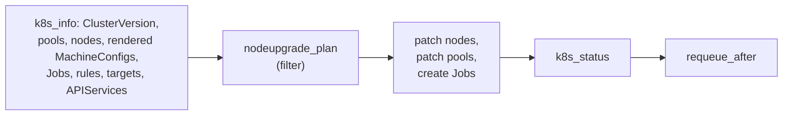

# Development

## Layout

| Path | What it is |
| --- | --- |
| `watches.yaml` | Which role reconciles which kind, how often, and the MutexRunConfig finalizer. |
| `roles/mutex_common/filter_plugins/nodeupgrade.py` | Every decision the operator makes. Pure Python: it gets cluster objects and returns patches, Jobs and status. |
| `roles/mutexrule`, `roles/mutextarget`, `roles/mutexrunconfig` | Read the cluster, call the filters, apply what they return. |
| `config/` | Kustomize manifests: CRDs, RBAC, the Deployment, samples and the CSV base for the OLM bundle. |
| `tests/unit/` | Unit tests for the filters, including a simulated rollout. |
| `tests/e2e/` | End-to-end test that drives a rollout through a running operator. |
| `tests/fake_mco.py` | A stand-in for the Machine Config Operator, used by both. |
| `sample-manifests/` | A canary pool and a CatalogSource for test installs. |
| `docs/operatorhub.md` | The description shown on OperatorHub. `make bundle` copies it into the CSV. |

Every MutexRunConfig reconcile runs the same steps:



The planner never assumes it ran before. Rollout progress lives in the pools' and nodes' labels and annotations, and Jobs are found by their labels and annotations, so restarts and missed reconciles are safe. When you change the planner, add a case to `tests/unit/test_nodeupgrade.py`; the `Cluster` helper there applies the planner's output to in-memory objects and runs the fake MCO, so a whole rollout runs in milliseconds.

Two Ansible details matter in the roles:

* The operator passes spec fields as variables (`mutex_rules`, `mutex_targets`, `canary`, `job_spec` and so on). They take precedence over registered results, so registered names must not clash with them.
* `watches.yaml` sets `markUnsafe: true`, so Jinja in a resource is never evaluated. Values derived from the resource are unsafe too, and Ansible returns them as strings; build anything with numbers (such as `observedGeneration`) in the filters.

## Setting up

You need Python 3.12, [yq](https://github.com/mikefarah/yq) v4, and Docker or Podman.

```shell
python3 -m venv .venv && . .venv/bin/activate
pip install -r requirements-dev.txt
ansible-galaxy collection install -r requirements.yml
```

`make` downloads `kustomize`, `operator-sdk`, `opm` and `ansible-operator` into `bin/` when a target needs them.

## Tests

```shell
make lint        # yamllint and ansible-lint
make test-unit   # the filters, in a second
```

### End to end

The end-to-end test needs a Kubernetes cluster with the operator running, and nothing else: it installs stand-ins for the OpenShift APIs the operator reads, creates three fake worker nodes, and runs `tests/fake_mco.py` to play the MCO. It then checks rule validation, target resolution, a full rollout one node at a time, a failed Job holding the rollout, and that deleting the MutexRunConfig restores everything.

Do not run it against an OpenShift cluster. It creates pools named `master`, `worker` and `canary`, and it refuses to start when it finds the real OpenShift APIs.

With [kind](https://kind.sigs.k8s.io/):

```shell
kind create cluster --name e2e
make docker-build IMG=localhost/openshift-node-upgrade-mutex-operator:dev
docker pull docker.io/library/busybox:1.37.0
kind load docker-image --name e2e localhost/openshift-node-upgrade-mutex-operator:dev docker.io/library/busybox:1.37.0
make deploy IMG=localhost/openshift-node-upgrade-mutex-operator:dev
E2E_JOB_NODE_SELECTOR='{"kubernetes.io/hostname": "e2e-control-plane"}' make test-e2e
```

Instead of building an image, you can run the operator from your working tree with `make run` in another terminal (with the Python requirements and collections installed). Set `E2E_RESTART_COMMAND` to a command that restarts the operator to also test that a new operator process resumes a rollout; CI deletes the operator pod.

CI (`.github/workflows/ci.yml`) runs the linters, the unit tests, `make bundle` (which validates the OLM bundle) and the end-to-end test on kind for every pull request.

### On OpenShift

Use a cluster you can update, ideally one with at least two workers.

1. Deploy the operator (`make deploy IMG=...`, or a CatalogSource from [`sample-manifests/catalogsource.yaml`](../sample-manifests/catalogsource.yaml)).
2. Create the canary pool, a namespace for Jobs, and the samples (`oc apply -k config/samples -n node-upgrade-mutex-operator`, after creating that namespace).
3. Check that the MutexRule and MutexTarget are `Valid` and the MutexRunConfig is `Idle`.
4. Start an update (`oc adm upgrade --to=<version>`), and follow `oc get mutexrunconfig -w`, `oc get mcp -w` and `oc get nodes -w`.

## Releasing

1. Set `VERSION` in the `Makefile` and run `make bundle`. It updates the image in `config/manager/kustomization.yaml` and the CSV base; also update the tag in `sample-manifests/catalogsource.yaml` and the version in the README's install command. Merge that.
2. Tag the merge commit `v<VERSION>` and push the tag. The release workflow pushes these images to ghcr.io and attaches the bundle to a GitHub release:
   * `ghcr.io/redhat-na-ssa/openshift-node-upgrade-mutex-operator:<VERSION>`
   * `ghcr.io/redhat-na-ssa/openshift-node-upgrade-mutex-operator-bundle:v<VERSION>`
   * `ghcr.io/redhat-na-ssa/openshift-node-upgrade-mutex-operator-catalog:v<VERSION>`

   After the first release, make the three packages public in the organization's package settings; new packages start private.
3. Submit the bundle to the community catalog. Fork [redhat-openshift-ecosystem/community-operators-prod](https://github.com/redhat-openshift-ecosystem/community-operators-prod), add the contents of the release's `bundle/` directory as `operators/openshift-node-upgrade-mutex-operator/<VERSION>/`, and open a pull request. The package uses `updateGraph: semver-mode`, so no `replaces` field is needed. A reviewer listed in the package's `ci.yaml` approves it.

   The operator only works on OpenShift, so the [k8s-operatorhub/community-operators](https://github.com/k8s-operatorhub/community-operators) listing (OperatorHub.io) is optional.
