# mutexrunconfig

Reconciles `MutexRunConfig` resources (`nodeupgrade.redhat-na-ssa.github.io/v1alpha1`). ansible-operator runs it for
every MutexRunConfig event and every 10 minutes (`watches.yaml`). On deletion the
`nodeupgrade.redhat-na-ssa.github.io/finalizer` finalizer runs it once more with `state: absent`. It is not meant to
be used outside the operator.

The user-facing description of the procedure, its conditions and recovery is in
[docs/USAGE.md](../../docs/USAGE.md#reconcile-procedure). The invariants, the state the role keeps in the cluster and
its assumptions about MCO are in [docs/DESIGN.md](../../docs/DESIGN.md). This file maps the procedure to the task
files.

In words:

1. `tasks/main.yml` stops at once for a MutexRunConfig outside the operator namespace.
2. `00` resolves the references. When the MutexRunConfig is being deleted, `08` restores and the reconcile ends.
3. `01` validates and `02` checks for an upgrade.
4. When an upgrade is available: `03` pauses, `04` labels, `05` re-points, each only after the one before succeeded.
5. When the control plane is done and the pools are re-pointed: `06` handles the nodes one at a time, with `07` for
   each Job.
6. When every node is done, or no node needs the upgrade: `08` restores.
7. `09` reports the paused pools and `Degraded` at the end of every reconcile that got past step 2.

## Gate facts and conditions

`tasks/main.yml` passes the result of each step to the next through a boolean gate fact. Each step sets its gate to
false at the top of its rescue and to true as the last task of its block. Most gate facts have the name of the
condition they report. One does not: the gate `UpgradabilityChecked` reports as the condition `UpgradeChecked`
(`tasks/main.yml:76`, `tasks/02-check-for-upgrade.yml:195`).

| Gate fact | Set by | Condition type |
| --- | --- | --- |
| `ConfigValidated` | `01-validate.yml` | `ConfigValidated` |
| `ClusterStateValidated` | `01-validate.yml` | `ClusterStateValidated` (a failure also writes `ConfigValidated=False` `ClusterStateInvalid`) |
| `UpgradabilityChecked` | `02-check-for-upgrade.yml` | `UpgradeChecked` |
| `UpgradeAvailable`, `UpgradeReady` | `02-check-for-upgrade.yml` | `UpgradeAvailable`, `UpgradeReady` |
| `TargetPoolsPaused` | `03-pause-machine-config-pools.yml` | `TargetPoolsPaused`, written by `09-report.yml` (and by `03` only on a failure) |
| `MutexRulesApplied` | `04-apply-mutex-rules-as-labels.yml` | `MutexRulesApplied` |
| `MCPUpdated` | `05-modify-machineconfigpool.yml` | `MCPUpdated` (also written by `main.yml` after a restore: `SelectorsRestored`) |
| `JobRun` | `main.yml` (true), `06-execute-jobs.yml` (false) | `JobRun` and `NodeUpgrade` |

The conditions `Reconciled`, `NodeVersionsKnown`, `NodeUpgrade` and `Degraded` have no gate fact.

## Task files

### tasks/main.yml

- **Runs:** on every reconcile and in the finalizer.
- **Reads:** `POD_NAMESPACE` and `ansible_operator_meta`; after the namespace check, the MutexRunConfig's
  `deletionTimestamp`.
- **Writes:** `Reconciled=False` (`NamespaceNotAllowed`) outside `POD_NAMESPACE`, except in a finalizer run; after a
  restore `MCPUpdated=False` (`SelectorsRestored`) and `UpgradeAvailable`/`UpgradeReady` `False` (`UpgradeFinished`).
- **Gates:** initialises every gate fact to false, then includes each step under the gates listed with it below.

The finalizer branch reads the MutexTargets that still exist in the operator namespace (references to other
namespaces are skipped, as `01` refuses them), runs `08` with the canary and their pools and nodes, and
ends the play, so `09` does not run then.

### tasks/00-resolve-references.yml

- **Runs:** always, after the namespace check.
- **Reads:** only the spec.
- **Writes:** nothing in the cluster. No gate fact.

It normalises `spec.mutexRules` and `spec.mutexTargets`: a missing `namespace` becomes the MutexRunConfig's
namespace. It builds each rule's node label `mutexrule.nodeupgrade.redhat-na-ssa.github.io/<rule>.<namespace>`, and
the run-time selector expressions on the release label `mutexrule.nodeupgrade.redhat-na-ssa.github.io/release`, whose
value is the SHA-1 of `<namespace>/<name>`: `In (<value>)` for the canary, `NotIn (<value>)` for the target pools. It
also builds one `<mutex label> DoesNotExist` per rule, for the canary's hold selector (`04`).

### tasks/01-validate.yml

- **Runs:** on every reconcile that is not a finalizer run.
- **Reads:** the MutexRules, the MutexTargets, the canary and target pools, all pools, nodes and APIServices.
- **Writes:** status only: `ConfigValidated` (`FetchSucceeded` or `ValidationFailed`), `ClusterStateValidated`
  (`APIServicesUp` or `APIServicesDown`). Sets the gates `ConfigValidated` and `ClusterStateValidated`.

The checks are read-only:

- the references, the label keys and that the references stay in the operator namespace;
- the rules' `ValidConfig`, and the targets' `ValidConfig`, `NodeListGathered` and non-empty `status.nodes`;
- the canary: it exists, it is not paused and not a target, its `matchLabels` select every target node, and its
  `matchLabels` and kept `matchExpressions` select no node outside the canary and the target pools (so no node of a
  `worker` pool that is not a target either);
- no canary or target pool carries another MutexRunConfig's `paused-by` or `modified-by`;
- no canary node (it matches the canary's `matchLabels` and original `matchExpressions` and is not a target node)
  carries the release label with another value; the message names the `oc label` command that removes it;
- `spec.canary.name` has not changed while a former canary still carries this MutexRunConfig's `In` expression.

It collects the canary's own nodes, except any node this run holds (this MutexRunConfig's `labelled-by` or one of its
mutex labels). `04` gives them the release label, and they are not counted as overlap. During a run, an expression
added to the canary's live `matchExpressions` is added to the saved original. A node without this run's release label,
in a pool the run still re-points or pauses but no longer targets, is not counted as overlap either. Last comes the
APIService gate: every APIService must be `Available`, with 4 checks (1 + 3 retries) 10 seconds apart.

### tasks/02-check-for-upgrade.yml

- **Runs:** when `ConfigValidated`.
- **Reads:** ClusterVersion `version` and the nodes.
- **Writes:** status only: `NodeVersionsKnown`, `UpgradeAvailable`, `UpgradeReady`, `UpgradeChecked`. Sets the gates
  `UpgradabilityChecked`, `UpgradeAvailable` and `UpgradeReady`; a failure sets all three to false.

The desired version is `status.desired.version`. The control plane is done when `status.history[0]` is `Completed` for
that version. Every target node must carry a semver `machineconfiguration.openshift.io/release-image-version` label,
or `NodeVersionsKnown=False` (`VersionLabelMissing`) names the nodes and nothing is paused. `UpgradeAvailable` is true
when a target node is behind, or still carries this MutexRunConfig's `released-by` (for any version) and needs its
cleanup Jobs. `UpgradeReady` is true when, in addition, the control plane is done. It also lists the nodes this run
released (also those that are no longer targets) and the target nodes MCO is updating, for the order in `06`.

### tasks/03-pause-machine-config-pools.yml

- **Runs:** when `ConfigValidated`, `UpgradabilityChecked` and `UpgradeAvailable`.
- **Reads:** the target pools that `01` read.
- **Writes:** `spec.paused: true` and `nodeupgrade.redhat-na-ssa.github.io/paused-by: <namespace>/<name>` on every
  target pool that is not paused yet. Sets the gate `TargetPoolsPaused`; on a failure it writes
  `TargetPoolsPaused=False` (`NotPaused`).

A pool someone else paused is left as it is, without `paused-by`, so the role never unpauses it.

### tasks/04-apply-mutex-rules-as-labels.yml

- **Runs:** when, in addition, `TargetPoolsPaused`.
- **Reads:** the nodes that `02` read and the canary that `01` read.
- **Writes:** node labels and annotations, and canary annotations (below). `MutexRulesApplied` (`ApplySucceeded` or
  `ApplyFailed`). Sets the gate `MutexRulesApplied`.

It labels every target node that is behind with one mutex label per rule and annotates it
`nodeupgrade.redhat-na-ssa.github.io/labelled-by: <namespace>/<name>`. The same patch removes any release label from
the node. Nodes this run already released, and nodes MCO is already updating through the canary, are skipped. Then the
holders (the nodes with this MutexRunConfig's `released-by`, for any version, and the canary's own nodes) get the
release label with this MutexRunConfig's value, and every other node loses that value.

While the canary does not select on that value yet, a change of the release label that canary membership depends on
comes only after one patch of the canary. That patch writes `nodeupgrade.redhat-na-ssa.github.io/release-labelled-at`
(the time), `modified-by` and `original-match-expressions`. On a canary that still has its own selector it also writes
the hold selector: the canary's original `matchExpressions` plus `<mutex label> DoesNotExist` per rule, which keeps the
nodes this run holds out of it. A canary that already holds (the hold selector, or an earlier build's `DoesNotExist`
selector) only gets the annotations. Target nodes without this MutexRunConfig's release value are labelled before that
patch, and the time is written again after the release label changes. A time that is empty, does not have the format
`YYYY-MM-DDTHH:MM:SSZ` or is later than now is written again.

### tasks/05-modify-machineconfigpool.yml

- **Runs:** when, in addition, `MutexRulesApplied`.
- **Reads:** the canary and target pools that `01` read.
- **Writes:** the pools' `matchExpressions`, `original-match-expressions` and `modified-by`; the canary's re-point
  removes `release-labelled-at`. `MCPUpdated` (`UpdateSucceeded`, `CanaryMembersLabelled` or `UpdateFailed`). Sets the
  gate `MCPUpdated`.

It saves each pool's original `matchExpressions` in `nodeupgrade.redhat-na-ssa.github.io/original-match-expressions`
and marks the pool `nodeupgrade.redhat-na-ssa.github.io/modified-by: <namespace>/<name>`. The canary comes first and
gets the expressions every target node satisfies plus `<release label> In (<value>)`. Then the target pools get
`<release label> NotIn (<value>)`. The target pools come first only while the canary still has an earlier build's
selector: `<mutex label> DoesNotExist` expressions next to expressions (ignoring mutex label keys) that differ from its
original ones, which the hold selector of `04` never has.

Nothing is re-pointed while the canary does not select on the release value yet and its `release-labelled-at` is less
than `mutexrunconfig_label_settle_seconds` old, does not have the time format, or was written in this reconcile. Then
`MCPUpdated=False` (`CanaryMembersLabelled`), `06` does not run, and a later reconcile, normally the next one,
re-points. [DESIGN.md](../../docs/DESIGN.md#the-settle-time) explains why.

### tasks/06-execute-jobs.yml

- **Runs:** once per node, when `JobRun` is true. `main.yml` sets it when `ConfigValidated`, `UpgradabilityChecked`,
  `UpgradeReady`, `TargetPoolsPaused`, `MutexRulesApplied` and `MCPUpdated` all hold.
- **Reads:** the MutexRunConfig again before each node, and the node.
- **Writes:** node patches (release, release mark cleared, leftover mutex labels removed) and, through `07`, Jobs.
  `JobRun` (`JobRunSucceeded` or `JobRunFailed`) and `NodeUpgrade` (`NodeAlreadyUpgraded`, `NodeUpgradeSucceeded` or
  `NodeUpgradeFailed`) after each node. A failure, or a MutexRunConfig being deleted, sets the gate `JobRun` to false,
  which skips the remaining nodes.

The nodes come in this order: nodes this run already released, then target nodes MCO is already updating, then the
other target nodes. For each node:

1. A node MCO is already updating (`desiredConfig` differs from `currentConfig`) is waited for first, until MCO reports
   it `Done` and `Ready`.
2. Before it takes a node down, the role stops the reconcile if MCO has meanwhile started updating another target
   node, so the next reconcile waits for that one first.
3. A node that is already upgraded and was not released by this run is skipped (`NodeAlreadyUpgraded`).
4. The pre-upgrade Jobs run, one for each rule whose mutex label the node still carries.
5. One patch removes the node's mutex labels and `labelled-by`, sets
   `nodeupgrade.redhat-na-ssa.github.io/released-by: <namespace>/<name>|<version>` and adds the release label. The
   release removes every mutex label of a node this MutexRunConfig holds, also that of a rule removed from
   `spec.mutexRules` during the run.
6. The role waits until the node has finished its upgrade: the version label, MCO `state` `Done` with `currentConfig`
   equal to `desiredConfig` and a rendered config of the canary, and `Ready`.
7. The cleanup Jobs run, one for each rule that has a `cleanUpJobSpec`. They do not depend on which pre-upgrade Jobs
   ran.
8. One patch removes `released-by` and the release label, so the node goes back to its paused pool.

A node that still carries this MutexRunConfig's `released-by`, for any version, resumes at step 6, so its cleanup Jobs
run before the next node. This also covers a released node that is no longer a target.

### tasks/07-run-job.yml

- **Runs:** from `06`, once per rule and phase (`pre` or `cleanup`).
- **Reads:** the Jobs in the rule's `jobNamespace` with the same `nodeupgrade.redhat-na-ssa.github.io/job-key` label,
  and then the Job it waits for.
- **Writes:** a new Job, only when no Job with that key exists that has not failed. No condition and no gate fact: a
  failure fails the task, and `06` reports it.

It builds the Job from the rule's `jobSpec` or `cleanUpJobSpec`:

- `NODE_NAME` (the node being upgraded) and `MUTEX_RULE` (the rule name) are appended to the `env` of every container
  and initContainer, replacing entries with those names. Because they come last, `$(NODE_NAME)` in another `env` value
  is not expanded; in `command` and `args` it is.
- `kubernetes.io/hostname NotIn [<node>]` is added to every required node affinity term, or a term is created.
- The name is `generateName` `<jobName>-`, or `cleanup-<jobName>-` for a cleanup Job.
- The `job-key` label is a hash of the MutexRunConfig, node, rule, phase and desired version. It leaves out the
  JobSpec, so a Complete Job is re-used even after the rule was edited.

It then polls the Job every `mutexrunconfig_job_poll_delay` seconds until it is Complete or Failed, for at most the
rule's `timeoutSeconds` (CRD default 3600) in this attempt. When that time runs out the task fails, but the Job keeps
running, and the next attempt waits for the same Job again, because it has not failed. A Failed Job is kept, and the
next attempt creates a new one.

### tasks/08-restore.yml

- **Runs:** at the end of a run and whenever no target node needs the upgrade (when `ConfigValidated`,
  `UpgradabilityChecked` and `JobRun` or not `UpgradeAvailable`), and in the finalizer.
- **Reads:** all pools and all nodes.
- **Writes:** the pools' selectors and annotations, the canary's `restored-at`, the nodes' labels and annotations, and
  `spec.paused: false`. No condition and no gate fact; `main.yml` reports the result.

It restores the saved selectors of the pools whose `modified-by` names this MutexRunConfig, the canary (and any pool
with an `In` expression on the release label) last. A restore also removes `release-labelled-at`. At the end of a run,
when a node still carries this MutexRunConfig's release value, the canary's restore writes
`nodeupgrade.redhat-na-ssa.github.io/restored-at: <time> <namespace>/<name>`.

It removes the release label from every node where it has this MutexRunConfig's value. At the end of a run that
happens only in a later pass that restores no selector and finds no `restored-at` of this MutexRunConfig younger than
`mutexrunconfig_label_settle_seconds`; that pass then removes `restored-at`. A `restored-at` of this MutexRunConfig
without the time, without the time format or later than now is written again. The finalizer removes the label in the
same pass, and its `restored-at` after that.

It removes the mutex labels from the nodes whose `labelled-by` names this MutexRunConfig, and this run's mutex labels
from target nodes without any `labelled-by`. A node whose `labelled-by` names another MutexRunConfig is left alone. It
removes this MutexRunConfig's `labelled-by` and `released-by` annotations, and unpauses only the pools whose
`paused-by` names it. Because it follows these marks, it also covers pools and nodes whose MutexTarget is gone.

### tasks/09-report.yml

- **Runs:** at the end of every reconcile, except outside the operator namespace and after the finalizer.
- **Reads:** all pools.
- **Writes:** status only: `TargetPoolsPaused` (`Paused` or `NotPaused`) and `Degraded`. No gate fact.

`TargetPoolsPaused` lists the pools paused by this MutexRunConfig, and target pools paused by someone else.
`Degraded=True` (`PoolsLeftPaused`) means a step failed while such a pool is paused or a pool still carries this run's
`modified-by`. Otherwise it is `False`, with `RunInProgress` or `NoPoolsPaused`. Both conditions are written only here,
so they lag behind a reconcile that runs for hours.

## Failure policy

A failure never unpauses a pool. The pools stay paused, `Degraded=True` explains why, and the next reconcile retries.
Deleting the MutexRunConfig is the way to abort.

## Inputs

| Variable | Source |
| --- | --- |
| `_nodeupgrade_redhat_na_ssa_github_io_mutexrunconfig_spec`, `_nodeupgrade_redhat_na_ssa_github_io_mutexrunconfig` | The MutexRunConfig spec and full object, passed by ansible-operator. |
| `ansible_operator_meta.name`, `.namespace` | The MutexRunConfig's name and namespace. |
| `state` | `absent` when the finalizer runs (`watches.yaml`). |
| `POD_NAMESPACE` (environment) | The operator's namespace. Unset means every namespace is allowed. |

### Defaults (`defaults/main.yml`)

| Variable | Default | Meaning |
| --- | --- | --- |
| `mutexrunconfig_node_upgrade_retries` / `_delay` | `120` / `60` | How long to wait (1 + retries checks, delay seconds apart: about 2 hours by default) for a released node to finish its upgrade, and for a node MCO was already updating to finish that update. |
| `mutexrunconfig_job_poll_delay` | `10` | Seconds between Job status polls. |
| `mutexrunconfig_apiservice_retries` / `_delay` | `3` / `10` | Retries of the APIService health check (1 + retries checks), and the delay between them. |
| `mutexrunconfig_label_settle_seconds` | `300` | How long a selector change that depends on a release label waits after that label changed: the re-point after the canary's own nodes got the label (`release-labelled-at`), and the removal of the label from them after the canary's restore (`restored-at`). See [DESIGN.md](../../docs/DESIGN.md#the-settle-time). |

No CRD field exposes these. To change them for the whole operator, set them under `vars:` of the MutexRunConfig
entry in `watches.yaml` and rebuild the image. How long the operator waits for each Job in one attempt is set per
MutexRule in `spec.timeoutSeconds` (CRD default 3600); there is no operator-wide setting. That wait does not stop the
Job: to bound a Job, set `jobSpec.activeDeadlineSeconds` below `timeoutSeconds`.

## Requirements

- ansible-core 2.18 or later (the `quay.io/operator-framework/ansible-operator:v1.42.3` base image).
- Collections `kubernetes.core` and `operator_sdk.util` (see `requirements.yml`). No `oc` binary and no Python
  libraries beyond those in the base image are needed.
- API access as listed in `config/rbac/role.yaml`.

## License

Apache-2.0, like the rest of the repository: see [LICENSE](../../LICENSE).
